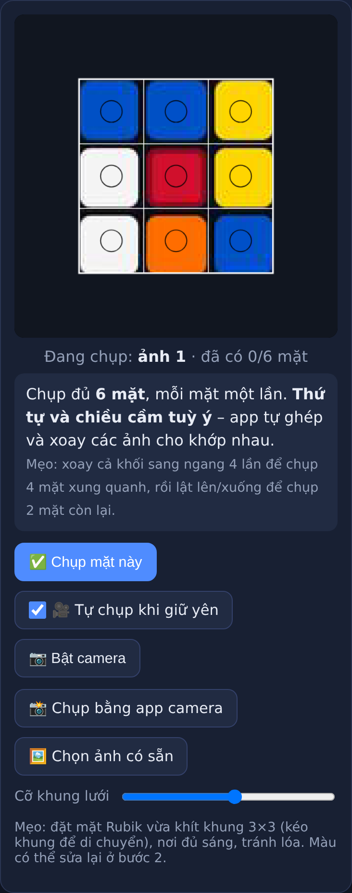
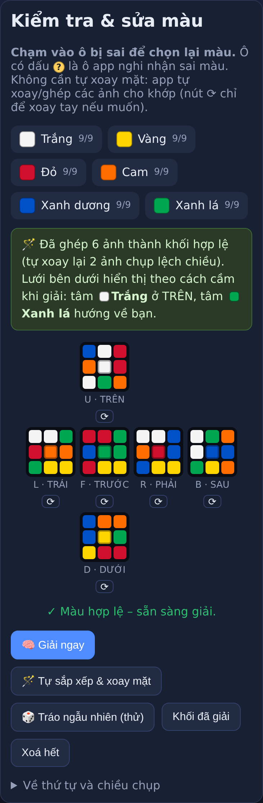
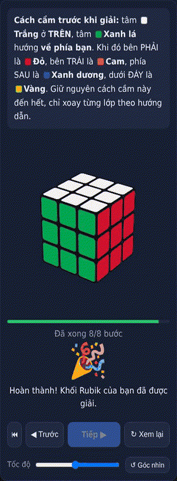

# Giải Rubik từng bước

[](https://github.com/nguyenduchoan/giai-rubik-tung-buoc/actions/workflows/ci.yml)
[](LICENSE)

Web giải khối Rubik 3×3 cho người mới: **chụp 6 mặt bằng camera điện thoại → app tự nhận màu, tự ghép và xoay các ảnh cho khớp → hướng dẫn giải từng bước bằng mô phỏng 3D**, toàn bộ bằng tiếng Việt.

Trang web tĩnh viết bằng HTML/CSS/JavaScript thuần: **không cần build, không phụ thuộc thư viện ngoài, không gửi ảnh lên máy chủ**. Mọi xử lý đều chạy trong trình duyệt.

> **English:** A zero-dependency, client-side web app that scans a 3×3 Rubik's cube with the phone camera, auto-detects colors, fixes faces captured in the wrong order/orientation, solves it with Kociemba's two-phase algorithm and walks you through each move with a 3D animation. UI and docs are in Vietnamese.

<p align="center">
  
  
  
</p>

## Tính năng

1. **Chụp các mặt**: mở trên điện thoại, app tự hỏi quyền camera. Đưa lần lượt từng mặt vào khung 3×3 và giữ yên khoảng 1 giây, app tự chụp (rung + nháy sáng) rồi chuyển sang mặt kế tiếp, bỏ qua mặt đã chụp. Vẫn có nút chụp tay, "Chụp bằng app camera" và "Chọn ảnh có sẵn".
2. **Kiểm tra màu**:
   - Chụp nhầm thứ tự (ví dụ đổi chỗ Phải/Trái) hoặc cầm lệch hướng (ảnh bị xoay 90°/180°): app **tự đổi chỗ và xoay các ảnh** cho thành khối hợp lệ, rồi đưa về cách cầm chuẩn.
   - Chụp trùng một mặt: app chỉ ra hai ảnh bị trùng và mặt còn thiếu, kèm nút chụp lại.
   - Có ô bị nhận sai màu: **chạm vào ô đó để chọn lại màu**. Ô đáng ngờ có dấu `?`. Khi tìm ra 2 ô bị nhận nhầm cho nhau (đỏ↔cam, trắng↔vàng…), app đánh dấu `!` và có nút "Áp dụng gợi ý".
3. **Hướng dẫn giải**: lời giải khoảng 20 bước (thuật toán hai pha Kociemba), mô phỏng 3D có hoạt ảnh, mô tả từng bước bằng tiếng Việt kèm màu tâm của mặt cần xoay. Bấm **Tiếp** để đi từng bước, hoặc **Tự chạy** để xem hết một lượt.

## Chạy trên máy

Cần một máy chủ tĩnh bất kỳ, ví dụ:

```bash
npm start                      # = node scripts/serve.js, mở http://127.0.0.1:8000/
# hoặc
python3 -m http.server 8000
```

- Trình duyệt chỉ cho dùng **camera trực tiếp** khi trang mở qua `https://` hoặc `localhost`.
- Mở bằng `http://<ip-LAN>` trên điện thoại thì camera bị chặn. Khi đó dùng nút **📸 Chụp bằng app camera** hoặc **🖼️ Chọn ảnh có sẵn**.
- Mở thẳng `index.html` (file://) vẫn dùng được chức năng chọn ảnh và tô màu thủ công.

**Thử nhanh không cần khối Rubik:** thư mục [`test-images/`](test-images/) có 6 ảnh mặt của một khối thật, trong đó 2 ảnh bị chụp lệch chiều. Chọn lần lượt từng ảnh bằng **🖼️ Chọn ảnh có sẵn** rồi bấm **Chụp mặt này**, giữ nguyên khung lưới mặc định. App sẽ tự xoay 2 ảnh lệch và cho lời giải 8 bước.

## Cách chụp

Chỉ cần chụp đủ 6 mặt, **thứ tự và chiều cầm tuỳ ý**. App tự ghép, xoay các ảnh cho khớp rồi đưa về cách cầm chuẩn (tâm trắng ở trên, tâm xanh lá ở trước, nếu khối dùng bảng màu phổ biến). Ở bước giải, app ghi rõ cầm khối thế nào và mỗi bước xoay mặt có tâm màu gì. Bảng dưới chỉ là cách chụp gợi ý:

| Thứ tự | Mặt | Cạnh trên của ảnh |
| --- | --- | --- |
| 1 | Trước (F) | mặt Trên |
| 2 | Phải (R): xoay cả khối sang trái 90° | mặt Trên |
| 3 | Sau (B): xoay tiếp sang trái | mặt Trên |
| 4 | Trái (L): xoay tiếp sang trái | mặt Trên |
| 5 | Trên (U): về lại mặt Trước, lật khối về phía mình | mặt Sau (mặt Trước ở cạnh dưới) |
| 6 | Dưới (D): lật tiếp 180° | mặt Trước |

Mẹo: chụp nơi đủ sáng, tránh lóa, đặt mặt Rubik vừa khít khung 3×3.

## Cách hoạt động

| Bước | Cách làm |
| --- | --- |
| Lấy màu | Lấy trung vị màu ở giữa mỗi ô. Chỉ tự chụp khi màu trong từng ô đồng đều và khối đứng yên; mặt chỉ có một màu thì phải thấy rõ khe tối giữa các ô (tránh chụp nhầm tường/bàn). |
| Nhận màu | Dùng 6 ô tâm làm mốc, ép mỗi màu đúng 9 ô bằng phép gán Hungarian trên khoảng cách màu kiểu LCh, nên chịu được ánh sáng lệch màu. Trước đó kiểm tra ảnh chụp trùng mặt trên màu ảnh gốc. |
| Ghép/xoay ảnh | Tìm kiếm quay lui trên mọi cách gán 6 ảnh vào 6 vị trí × 4 hướng xoay, cắt nhánh sớm bằng ràng buộc cạnh/góc, chọn cách ít thay đổi nhất. |
| Kiểm tra hợp lệ | Chuyển sang dạng cubie và kiểm tra đủ 8 góc/12 cạnh, tổng hướng góc/cạnh và tính chẵn lẻ của hoán vị. |
| Giải | Thuật toán hai pha của Herbert Kociemba, bảng tra dựng lúc chạy (~1 giây), chạy trong Web Worker. |

## Cấu trúc

| Đường dẫn | Vai trò |
| --- | --- |
| `index.html`, `css/style.css` | Giao diện 3 bước |
| `js/cube.js` | Mô hình sticker, bước xoay, chuyển sang dạng cubie, kiểm tra hợp lệ, tự ghép/xoay ảnh |
| `js/solver.js` | Bộ giải hai pha Kociemba |
| `js/solver-worker.js` | Chạy bộ giải trong Web Worker (tự quay về luồng chính nếu bị chặn) |
| `js/vision.js` | Lấy mẫu màu từ ảnh, phân loại màu, phát hiện chụp trùng, đánh dấu ô đáng ngờ |
| `js/cube3d.js` | Khối 3D bằng CSS transform + hoạt ảnh xoay |
| `js/app.js` | Điều khiển giao diện và luồng 3 bước |
| `tests/` | Kiểm thử Node và kiểm thử trình duyệt (camera giả) |
| `test-images/` | 6 ảnh mặt mẫu để thử thủ công |
| `scripts/` | Máy chủ tĩnh, chạy kiểm thử trình duyệt, script triển khai |

## Kiểm thử

```bash
npm test            # Node >= 22: bước xoay, kiểm tra hợp lệ, bộ giải, nhận màu, tự ghép/xoay
npm run test:e2e    # cần Google Chrome: giả lập điện thoại + camera (4 kịch bản chụp) và các ca trạng thái
```

| Lệnh | Nội dung |
| --- | --- |
| `node tests/solver.test.js` | Bước xoay, kiểm tra hợp lệ (gồm mọi cách đổi 2 ô), giải 40 trạng thái ngẫu nhiên |
| `node tests/vision.test.js` | Nhận màu dưới ánh sáng/nhiễu mô phỏng, phát hiện chụp trùng mặt |
| `node tests/arrange.test.js` | Tự đổi chỗ/xoay các mặt chụp nhầm, gợi ý sửa 2 ô nhận nhầm màu (có giới hạn thời gian) |
| `node tests/serve.test.js` | Máy chủ chạy thử: trả đúng file, từ chối đường dẫn xấu (NUL, `..`, file ẩn, symlink ra ngoài) mà không dừng |
| `npm run test:e2e` | Chrome headless + camera giả: tự chụp, sửa màu, giải hết, huỷ lời giải khi dữ liệu đổi, chuyển qua lại giữa camera và ảnh (kể cả ảnh hỏng, quyền camera trả về chậm). Kịch bản `MISTAKES=0` chụp đúng; `1` nhầm thứ tự/hướng; `2` thứ tự và chiều hoàn toàn tuỳ ý; `3` thêm 2 ô đỏ/cam bị nhận nhầm. Chạy riêng một kịch bản: `MISTAKES=2 npm run test:e2e`. |
| `node tests/e2e-state.js` | Nhập ảnh qua "Chọn ảnh có sẵn": chụp trùng thì chặn giải và huỷ lời giải cũ, giải lại khi hình 3D đang xoay, chụp lại/quay lại bước chụp không mất màu đã sửa, chụp thiếu mặt + tô tay, lời giải xong khi đang ở bước khác, khoá giữ màn hình, tự cập nhật không mất dữ liệu nhập tay (mất ~2 phút vì phải chờ chu kỳ kiểm tra bản mới). |

Nếu lệnh `google-chrome` không có trên PATH (ví dụ macOS), đặt biến `CHROME_BIN`:

```bash
CHROME_BIN="/Applications/Google Chrome.app/Contents/MacOS/Google Chrome" npm run test:e2e
```

## Triển khai

Chỉ cần chép `index.html`, `css/` và `js/` lên bất kỳ dịch vụ web tĩnh nào có **HTTPS** (GitHub Pages, Netlify, Cloudflare Pages, nginx…). Không cần cấu hình gì thêm.

- Nếu máy chủ cache JS/CSS lâu, hãy đổi tham số `?v=` trong `index.html` và `js/app.js` mỗi lần phát hành để điện thoại không dùng bản cũ.
- Tab đã mở sẵn sẽ tự phát hiện bản mới khi người dùng quay lại tab: tự tải lại nếu chưa chụp/giải gì, nếu đang dở thì hiện nút **↻ Tải lại**.
- `scripts/deploy-hub.sh` là script triển khai lên một "Server Hub" tự dựng (chạy test, đặt `?v=` theo nội dung, tráo bản mới vào `$HUB_ROOT/rubik`). Có thể tham khảo khi viết script cho máy chủ của bạn.

## Đóng góp

Mọi đóng góp đều được hoan nghênh: báo lỗi, đề xuất tính năng, cải thiện nhận màu, dịch giao diện… Xem [CONTRIBUTING.md](CONTRIBUTING.md) và [Quy tắc ứng xử](CODE_OF_CONDUCT.md). Báo lỗ hổng bảo mật theo [SECURITY.md](SECURITY.md).

## Ghi công

- Thuật toán hai pha giải Rubik: [Herbert Kociemba](https://kociemba.org/cube.htm). Mã trong `js/solver.js` là bản cài đặt riêng của dự án.
- Quy tắc ứng xử dựa trên [Contributor Covenant 2.1](https://www.contributor-covenant.org/version/2/1/code_of_conduct/).

## Giấy phép

[MIT](LICENSE)
