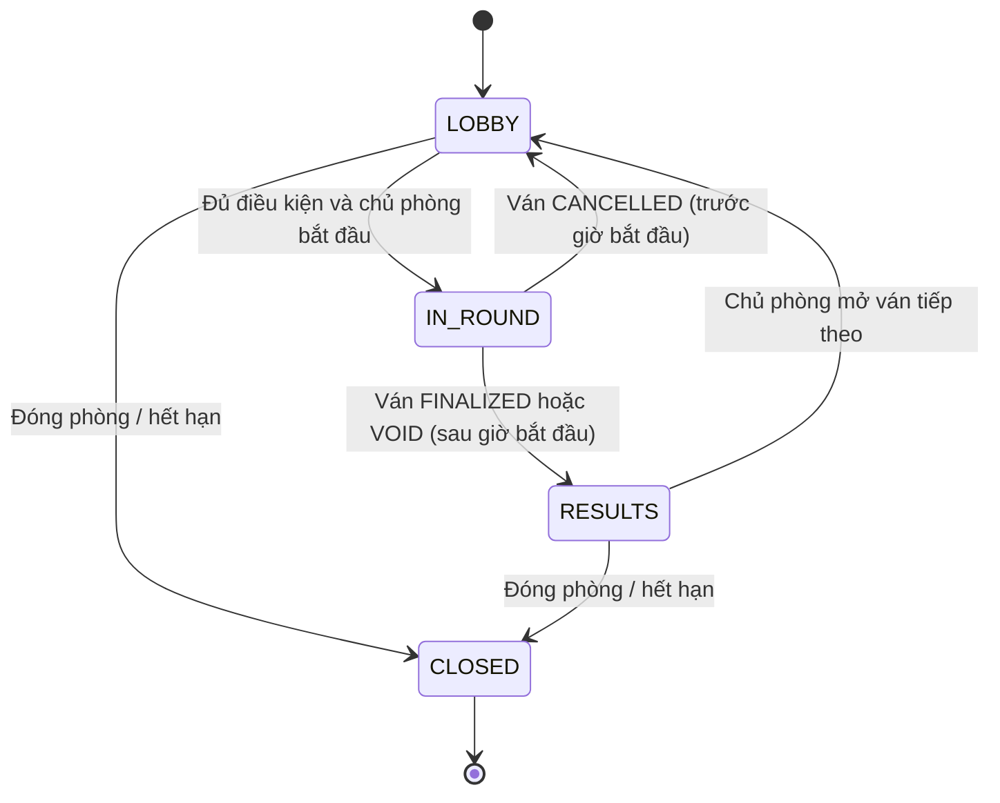
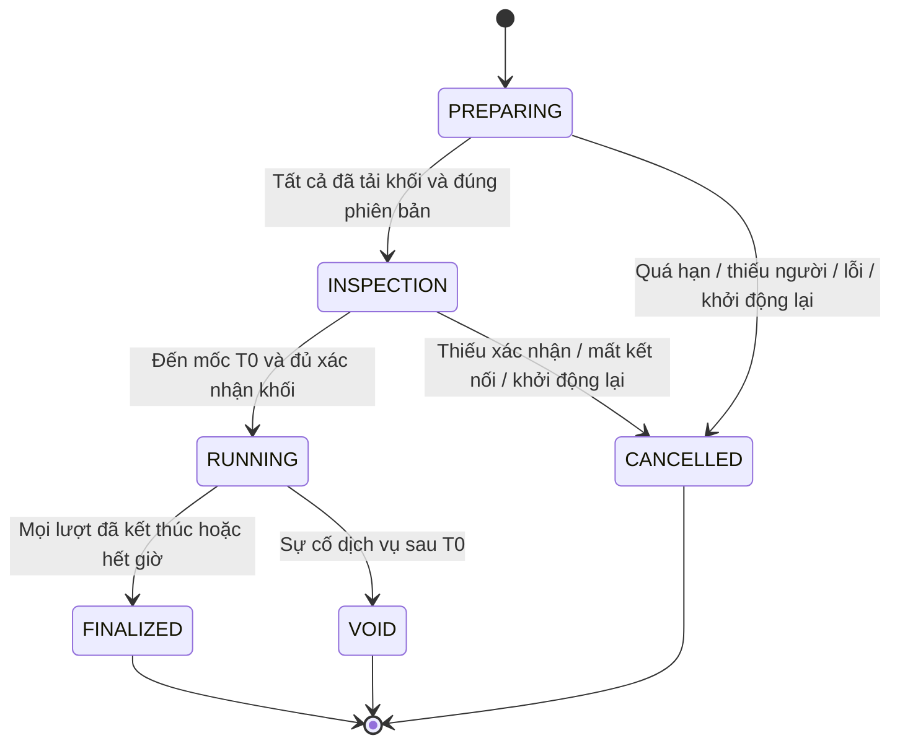
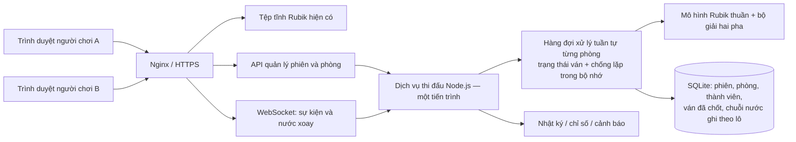
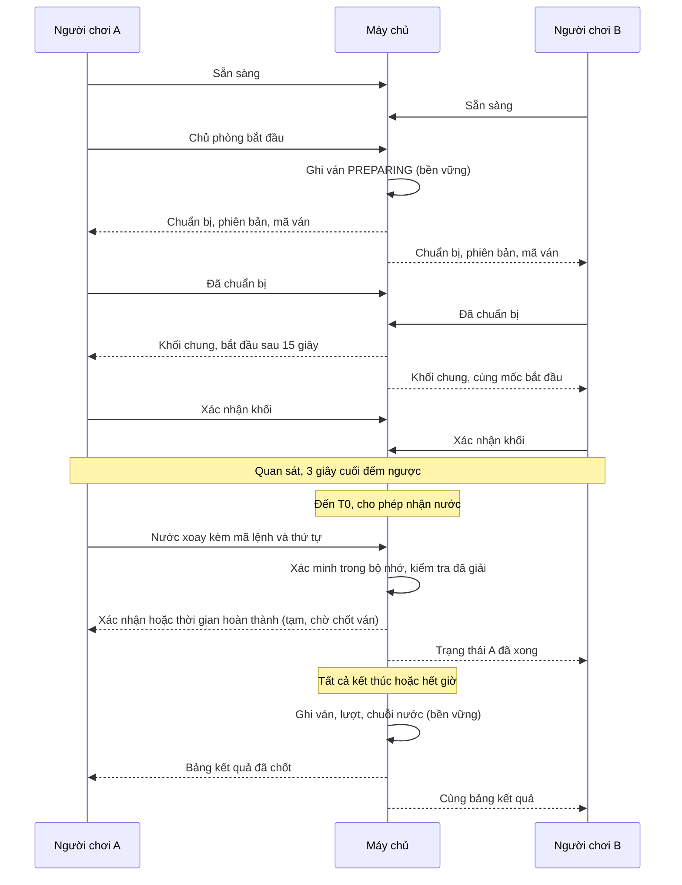

# Phân tích nghiệp vụ và kế hoạch hệ thống: phòng thi đấu Rubik online

- **Trạng thái:** D-01…D-10 được chủ sản phẩm duyệt theo giá trị đề xuất ngày 17/11/2026; phần MVP đã hiện thực và kiểm chứng — xem [mục 22](#22-trạng-thái-hiện-thực-17112026). UAT với người chơi thật (ONL-09/10) chưa làm.
- **Ngày:** 11/11/2026.
- **Mục tiêu tài liệu:** chuyển ý tưởng phòng thi đấu thành yêu cầu có thể kiểm chứng, luật chơi nhất quán, phương án hệ thống và các bước bàn giao rõ ràng.
- **Vai trò phân tích:** BA — phân tích nghiệp vụ; SA — phân tích và thiết kế hệ thống.
- **Bản sửa:** 11/11/2026 — tiếp thu rà soát: bền vững theo ranh giới ván (D-10), SQLite mặc định (D-08), nối lại cộng dồn (D-05), luật loại thành viên (BR-27), chuyển chủ chỉ ngoài ván (BR-22), gộp hủy trước giờ vào `CANCELLED`, bộ tráo random-state (BR-08), phác thảo màn hình (5.1) và phụ lục mã lỗi.

Tài liệu được soạn ban đầu ở nhánh `feature/online-room-plan` (chưa commit tại đó); bản trong kho mã này là bản hiện hành, kèm trạng thái hiện thực ở mục 22. Các mục 0–21 giữ nguyên nội dung phân tích gốc.

**Gợi ý đọc để duyệt:** người duyệt chỉ cần đọc [tóm tắt ở mục 0](#0-tóm-tắt-một-trang-để-duyệt) rồi [các quyết định ở mục 1](#1-những-gì-đã-xác-nhận-và-những-gì-cần-duyệt), [luật thi ở mục 6](#6-luật-nghiệp-vụ-đề-xuất) và [tình huống ngoại lệ ở mục 8](#8-các-tình-huống-cần-thiết-kế-trước). Phần kỹ thuật nằm ở mục 10–16; kiểm chứng và giao việc ở mục 17–21; mã lỗi ở phụ lục A.

## 0. Tóm tắt một trang để duyệt

**Đề xuất sản phẩm:** phòng thi giao hữu 2–8 người trên Rubik ảo 3×3; mọi người nhận cùng một khối tráo, quan sát 15 giây, giải tối đa 10 phút, xếp hạng từng ván rồi thi lại trong cùng phòng. Vào phòng bằng mã mời và biệt danh, chưa cần tài khoản. Máy chủ xác minh từng nước xoay; trình duyệt chỉ hiển thị.

**Quyết định cần có ngay (chặn triển khai):**

| Mã | Câu hỏi | Đề xuất hiện tại |
| --- | --- | --- |
| D-01 | Chỉ giao hữu, không dùng kết quả cho thưởng/xếp hạng công khai? | Có |
| D-02, D-03 | 2–8 người; quan sát 15 giây; giải tối đa 10 phút? | Có |
| D-05 | Mất mạng vẫn tính giờ; tổng thời gian ngắt tối đa 60 giây/lượt? | Có |
| D-08, D-10 | Một tiến trình Node.js + WebSocket + SQLite; trạng thái ván trong bộ nhớ, chỉ ghi bền vững ở ranh giới ván/phòng? | Có |
| Q-05 | Hub có chạy được một tiến trình Node sau nginx với HTTPS/WSS không? Ai vận hành? | Chưa có câu trả lời |

**Nguyên tắc kỹ thuật cốt lõi:** mọi ván đang chạy đều bị hủy (`VOID`) khi dịch vụ khởi động lại (BR-25), nên không cần ghi từng nước xoay xuống đĩa trước khi phản hồi. Máy chủ giữ ván trong bộ nhớ, ghi bền vững khi vào/rời phòng, khóa ván và chốt kết quả. Điều này giữ nguyên tính xác minh của máy chủ, bỏ yêu cầu PostgreSQL ở bản đầu và giảm đáng kể gánh hạ tầng cho Hub.

**Giới hạn phải chấp nhận:** không chứng minh được người chơi tự nghĩ lời giải (repo đã có bộ giải trong trình duyệt); thời gian chính thức đo tại máy chủ nên chịu ảnh hưởng mạng; thời gian quan sát thực tế của người mạng chậm ngắn hơn một chút; Hub hiện chỉ phục vụ tệp tĩnh.

**Việc trước khi viết mã:** ONL-01 (duyệt tài liệu này), ONL-02 (bàn giao Chơi tự do), ONL-03 (thử nghiệm hai người để kiểm chứng độ trễ và giao thức).

## 1. Những gì đã xác nhận và những gì cần duyệt

### 1.1. Yêu cầu người dùng đã xác nhận

| Mã | Yêu cầu | Nguồn |
| --- | --- | --- |
| C-01 | Thi trên Rubik ảo trong ứng dụng; mọi người nhận cùng một trạng thái tráo | Trả lời trực tiếp của người dùng |
| C-02 | Ưu tiên phòng riêng, mời bằng mã hoặc liên kết | Trả lời trực tiếp của người dùng |
| C-03 | Nhập biệt danh để tham gia; giai đoạn đầu chưa yêu cầu tài khoản | Trả lời trực tiếp của người dùng |
| C-04 | Lập kế hoạch kỹ và lưu thành Markdown để xem xét trước | Yêu cầu hiện tại |
| C-05 | Agent khác đang triển khai Chơi tự do theo kế hoạch trước | Người dùng thông báo |

### 1.2. Đề xuất sản phẩm để duyệt

Phiên bản đầu là **phòng thi giao hữu 2–8 người**, giải cùng một khối 3×3, có thời gian quan sát chung, bắt đầu cùng một mốc và xếp hạng từng ván. Máy chủ xác minh các nước xoay và kết quả. Người chơi có thể thi lại ngay trong phòng.

| Mã quyết định | Đề xuất | Trạng thái |
| --- | --- | --- |
| D-01 | Phòng giao hữu, không dùng kết quả cho giải thưởng hoặc xếp hạng công khai trong phiên bản đầu | Cần duyệt |
| D-02 | Tối thiểu 2, tối đa 8 người/phòng; chủ phòng cũng là người chơi | Cần duyệt |
| D-03 | Quan sát 15 giây; 3 giây cuối hiển thị đếm ngược; tối đa 10 phút giải | Cần duyệt |
| D-04 | Xếp hạng từng ván, thi lại với khối mới; chưa cộng điểm nhiều ván | Cần duyệt |
| D-05 | Mất mạng vẫn tính giờ; cho nối lại khi tổng thời gian ngắt kết nối cộng dồn trong một lượt chưa quá 60 giây, tính từ lúc máy chủ xác định mất kết nối | Cần duyệt |
| D-06 | Chủ phòng không sửa luật, loại người đang thi hoặc hủy ván sau khi đã bắt đầu | Cần duyệt |
| D-07 | Lỗi dịch vụ làm gián đoạn ván đang chạy: hủy kết quả toàn ván đó, không phạt một người riêng lẻ | Cần duyệt |
| D-08 | Kiến trúc đề xuất: giao diện hiện có + một tiến trình Node.js (`ws` + SQLite); PostgreSQL chỉ khi cần nhiều tiến trình/máy | Đề xuất SA, cần chốt điều kiện vận hành |
| D-09 | Tải thử ban đầu 20 phòng × 8 người; kết quả và nhật ký nước xoay lưu 7 ngày | Giả định để định cỡ, cần duyệt |
| D-10 | Trạng thái ván và chống lặp lệnh giữ trong bộ nhớ của tiến trình; chỉ ghi bền vững ở ranh giới phòng/ván (vào/rời, khóa ván, chốt kết quả), không ghi từng nước trước khi phản hồi | Đề xuất SA, cần duyệt |

Các giá trị trên là đề xuất, không phải yêu cầu đã được người dùng xác nhận. Nếu thay một quyết định, cần cập nhật các luật, tình huống nghiệm thu và phần kỹ thuật liên quan trong cùng tài liệu.

## 2. Cách thực hiện phân tích và các điểm kiểm soát

### 2.1. Bằng chứng hiện có

Đã đọc mã nền `b3d9f7b`, cơ chế triển khai, bộ kiểm tra và các điểm tích hợp của phần Chơi tự do đang sửa. Chưa thực hiện phỏng vấn nhóm người chơi, thử nghiệm sử dụng, đo tải dịch vụ online hoặc kiểm tra cấu hình sản xuất cho WebSocket/cơ sở dữ liệu.

| Bằng chứng | Kết luận sử dụng được | Giới hạn |
| --- | --- | --- |
| [README.md](../README.md), [scripts/serve.js](../scripts/serve.js) | Ứng dụng hiện chủ yếu là trang tĩnh, xử lý Rubik trong trình duyệt; máy chủ thử chỉ phục vụ tệp | Chưa có dịch vụ quản lý phòng/phiên trong repo |
| [scripts/deploy-hub.sh](../scripts/deploy-hub.sh) | Đang chép HTML/CSS/JS vào Server Hub và dựng thư mục công khai | Chưa triển khai tiến trình thi đấu hoặc cơ sở dữ liệu |
| [js/cube.js](../js/cube.js) | Có mô hình 54 ô, phép xoay, kiểm tra hợp lệ và sinh chuỗi tráo độc lập giao diện | Bộ sinh hiện dùng chuỗi nước ngẫu nhiên; chưa phải bằng chứng về bộ tráo thi đấu chuẩn |
| [js/cube3d.js](../js/cube3d.js), [js/play-state.js](../js/play-state.js) | Có phần dựng hình, trạng thái tự chơi và hoàn tác có thể khảo sát để tái sử dụng | Bản nền chỉ xoay lớp ngoài; phần mở rộng đang được agent khác sửa |
| [js/app.js](../js/app.js) | Có bộ giải trong trình duyệt và cơ chế tự tải lại khi có bản mới | Cần bảo vệ phiên thi khỏi tải lại tự động và các thao tác tự chơi |
| [tests/lib/chrome.js](../tests/lib/chrome.js) | Có công cụ điều khiển Chrome để kiểm tra chuột/chạm | Chưa có bằng chứng thử nhiều người cùng phòng, độ trễ hoặc mất mạng |

Các mô-đun `js/play-moves.js`, `js/play-gesture.js` và thay đổi toàn màn hình đã xuất hiện trong vùng mã đang triển khai. Đây là **phụ thuộc chưa nghiệm thu**, không được xem là giao diện lập trình cuối cùng.

### 2.2. Quy trình BA/SA áp dụng

| Bước | Hoạt động | Đầu ra | Điều kiện chuyển bước |
| --- | --- | --- | --- |
| 1. Xác định vấn đề | Chốt đối tượng, mục tiêu và hoàn cảnh chơi | C-01…C-05, mục tiêu và phạm vi | Chủ sản phẩm xác nhận |
| 2. Khai thác yêu cầu | Xem hành trình, phỏng vấn/thử với người mới và người chơi thường xuyên | Các nhu cầu, trở ngại, giả định được ghi nguồn | Các câu hỏi ảnh hưởng luật thi có câu trả lời |
| 3. Mô hình hóa nghiệp vụ | Mô tả vai trò, trạng thái, luật, ngoại lệ và dữ liệu | Mục 4–9 của tài liệu | Không còn luật mâu thuẫn về bắt đầu/kết thúc/mất mạng |
| 4. Đánh giá phương án | So sánh giải pháp và kiểm chứng rủi ro khó nhất | Quyết định kiến trúc, thử nghiệm đồng bộ/khôi phục | Chứng minh được tính nhất quán và kết quả đúng |
| 5. Đặc tả để thực hiện | Liên kết yêu cầu → công việc → tiêu chí kiểm tra | Ma trận truy vết và kế hoạch theo giai đoạn | Có người chịu trách nhiệm, đầu vào và đầu ra cho từng phần |
| 6. Nghiệm thu | Kiểm tra tự động, thực tế và UAT — người dùng xác nhận đáp ứng nghiệp vụ | Bằng chứng, lỗi còn lại, quyết định phát hành | Đạt tiêu chí bắt buộc và giới hạn được chấp nhận |
| 7. Đánh giá sau phát hành | Đo kết quả, phân tích sự cố và phản hồi | Quyết định cải tiến tiếp theo | Có số liệu thật thay vì suy đoán |

Tài liệu này cung cấp bản phân tích ban đầu cho các bước 1–5. Những hoạt động cần người dùng thật hoặc hệ thống chạy thật vẫn là việc phải thực hiện sau, không được ghi như đã hoàn tất.

### 2.3. Người tham gia và quyền quyết định

| Vai trò | Trách nhiệm chính | Quyết định/bằng chứng cần có |
| --- | --- | --- |
| Chủ sản phẩm | Chọn mục tiêu, phạm vi, luật và thứ tự ưu tiên | Duyệt D-01…D-10; chấp nhận kết quả UAT |
| Người chơi mới | Kiểm tra hiểu cách vào phòng, sẵn sàng, bắt đầu và kết quả | Thử luồng không cần người hướng dẫn |
| Người chơi thường xuyên | Kiểm tra thao tác, nhịp thi, tính dễ hiểu của xếp hạng | Phản hồi trên máy tính và điện thoại |
| BA | Quản lý yêu cầu, ngoại lệ, truy vết và thay đổi | Mỗi yêu cầu có nguồn, luật và tiêu chí nghiệm thu |
| SA/người phụ trách kỹ thuật | Chốt thiết kế, giao diện tích hợp và giới hạn | Đồng bộ, tính giờ, dữ liệu và phục hồi được kiểm chứng |
| Người phát triển và kiểm thử | Hiện thực, kiểm tra và ghi bằng chứng | Không tự đổi luật để dễ viết mã |
| Người vận hành Server Hub | Cấu hình dịch vụ, dữ liệu, giám sát và phục hồi | Xác nhận khả năng triển khai, sao lưu và quay về phiên bản trước |

## 3. Mục tiêu, giá trị và phạm vi

### 3.1. Mục tiêu kinh doanh/người dùng

- **OBJ-01:** một nhóm bạn tạo và vào cùng phòng nhanh, không cần đăng ký tài khoản.
- **OBJ-02:** mọi người hiểu vì sao ván bắt đầu, ai đã hoàn thành và vì sao có thứ hạng đó.
- **OBJ-03:** kết quả dựa trên trạng thái khối được máy chủ xác minh; gửi trùng hoặc nối lại không tạo kết quả khác nhau.
- **OBJ-04:** thao tác trên điện thoại kế thừa Chơi tự do, gồm lớp giữa/hai lớp và đổi góc nhìn.
- **OBJ-05:** sự cố mạng có cách xử lý rõ ràng, đủ thông tin để tiếp tục hoặc kết thúc ván.

Chỉ số đề xuất để đánh giá thử nghiệm: ít nhất 80% nhóm thử tạo/vào phòng và bắt đầu ván trong 2 phút mà không cần hỗ trợ; không có kết quả được công bố khi chưa xác minh; không có ván có hai bộ kết quả chính thức khác nhau. Đây là mục tiêu cần đo, chưa có số liệu nền.

### 3.2. Phạm vi phiên bản đầu — MVP, phiên bản tối thiểu dùng được

Các mức ưu tiên dưới đây thuộc **phương án MVP đang đề xuất**, chưa phải xác nhận duyệt của người dùng. “Bắt buộc” nghĩa là phải có để phương án này đáp ứng mục tiêu nếu được chọn triển khai.

| Mức ưu tiên | Nội dung |
| --- | --- |
| Bắt buộc | Tạo/vào phòng riêng, biệt danh, liên kết mời, danh sách người chơi, sẵn sàng, chủ phòng và chuyển chủ |
| Bắt buộc | Một trạng thái tráo chung, quan sát/đếm ngược, giờ bắt đầu chung, máy chủ xác minh nước xoay và hoàn thành |
| Bắt buộc | Kết quả từng ván, không hoàn thành, hủy do sự cố, thi lại trong cùng phòng |
| Bắt buộc | Nối lại, chống áp dụng lệnh trùng, chống sửa kết quả từ trình duyệt, giới hạn tài nguyên và theo dõi lỗi |
| Bắt buộc | Điều khiển điện thoại/máy tính; trạng thái thi độc lập với khối tự chơi và bộ giải |
| Nên có sau luồng cốt lõi | Xem lại các ván của phòng trong thời hạn lưu, sao chép kết quả tóm tắt |
| Xem xét sau thử nghiệm | Khán giả có quyền riêng, xem lại chuỗi nước sau ván, bộ cấu hình thời gian phù hợp trình độ |
| Giai đoạn sau | Tài khoản, ghép đối thủ, xếp hạng công khai, thi nhiều ván có tổng điểm, giải đấu, chat, Rubik thật |

Chưa yêu cầu độ tin cậy cho thi có tiền thưởng hoặc chống chương trình tự giải ở mức thi đấu chuyên nghiệp. Đây là ranh giới sản phẩm cần D-01 được chấp nhận trước khi dùng kết quả rộng hơn trong các phòng giao hữu.

## 4. Khái niệm, vai trò và quyền hạn

**Phòng** tồn tại qua nhiều ván. **Ván** có danh sách người thi, luật và khối ban đầu được khóa. **Lượt giải** là trạng thái của một người trong một ván. **Phiên khách** định danh trình duyệt bằng mã bí mật do máy chủ cấp; biệt danh chỉ là tên hiển thị. **DNF — không hoàn thành** là kết quả của một lượt. **VOID — ván bị hủy** là kết quả cấp ván do sự cố xảy ra **sau khi ván đã bắt đầu chạy**. Mọi trường hợp không tới được giờ bắt đầu — thiếu người, quá hạn chuẩn bị hay sự cố dịch vụ — đều là **CANCELLED — hủy trước giờ** kèm lý do; hai trường hợp này có cùng hậu quả (về phòng chờ, bỏ sẵn sàng) nên không tách thành hai trạng thái.

| Hành động | Chủ phòng | Người chơi | Người chờ ván sau | Hệ thống |
| --- | --- | --- | --- | --- |
| Xem phòng mình đã tham gia, sao chép mã mời | Có | Có | Có | Kiểm tra quyền |
| Đổi biệt danh khi chưa khóa ván | Có | Có, tên của mình | Có, tên của mình | Kiểm tra trùng/định dạng |
| Sẵn sàng/hủy sẵn sàng | Có, cho mình | Có, cho mình | Khi trở về phòng chờ | Kiểm tra phiên và phiên bản |
| Bắt đầu ván | Khi đủ điều kiện | Không | Không | Chốt danh sách và giờ |
| Mở lại phòng chờ để thi ván tiếp | Có, sau khi ván kết thúc | Không | Không | Đặt lại sẵn sàng |
| Đổi cấu hình/loại thành viên/đóng phòng | Chỉ ở phòng chờ hoặc sau ván | Không | Không | Ghi sự kiện; phiên bị loại vào danh sách chặn của phòng theo BR-27 |
| Xoay khối trong ván | Lượt của mình | Lượt của mình | Không | Xác minh từng lệnh |
| Bỏ cuộc | Lượt của mình | Lượt của mình | Không áp dụng | Ghi DNF |
| Xác định hoàn thành, thời gian, thứ hạng | Không | Không | Không | Có |
| Bàn giao chủ động | Chỉ ở phòng chờ/kết quả | Có thể được nhận | Có thể được nhận | Kiểm tra người nhận còn kết nối |
| Chuyển chủ do rời/mất kết nối | Không tự chọn kết quả chuyển | Có thể được chọn | Có thể được chọn | Chỉ thực hiện ở phòng chờ/kết quả theo BR-22; đang thi thì ván tự chạy, chuyển chủ khi ván kết thúc; tối đa một chủ |

Chủ phòng là vai trò tổ chức, không có quyền sửa đồng hồ hoặc kết quả người khác. Thành viên có mã mời được vào phòng theo giới hạn; mã mời không cấp quyền điều khiển lượt giải của thành viên khác.

## 5. Hành trình và các màn hình

1. **Vào Thi đấu:** chọn Tạo phòng hoặc Nhập mã; thông báo dịch vụ không khả dụng nếu máy chủ đang bảo trì.
2. **Tạo/vào phòng:** nhập biệt danh, nhận phiên khách, vào phòng chờ; liên kết mời có thể đi thẳng đến bước nhập tên.
3. **Phòng chờ:** thấy mã phòng, luật ván, chủ phòng, trạng thái kết nối và sẵn sàng; lý do chưa thể bắt đầu phải được hiển thị.
4. **Chuẩn bị:** chủ phòng bấm bắt đầu; máy chủ khóa danh sách và kiểm tra các máy đã sẵn sàng tải khối/phiên bản.
5. **Quan sát:** cùng trạng thái tráo được phát cho mọi người; được nhìn quanh, chưa được xoay lớp; ba giây cuối đếm ngược rõ bằng chữ/số.
6. **Đang thi:** sân chơi lớn, giờ đang chạy, trạng thái kết nối, danh sách trạng thái đối thủ, nút Bỏ cuộc; hạn chế các điều khiển gây nhầm.
7. **Hoàn thành:** trình duyệt hiện “Đang xác nhận” khi thấy khối đã giải; máy chủ xác nhận mới hiện thời gian chính thức.
8. **Kết quả:** thứ hạng, thời gian, số nước, DNF và lý do, hoặc thông báo ván bị hủy; chủ phòng có Thi lại, mọi người có Rời phòng; người khác thấy đang chờ chủ chuẩn bị ván tiếp.
9. **Thi lại:** chủ đưa phòng về chờ, hủy mọi trạng thái sẵn sàng cũ; khi đủ điều kiện bắt đầu lại thì có khối mới và mã ván mới. Khối tự chơi cá nhân vẫn độc lập.

Giao diện có tab **Thi đấu** riêng. Tái dùng phần dựng khối và điều khiển đã nghiệm thu từ Chơi tự do, nhưng vòng đời phòng và trạng thái thi do bộ điều khiển online riêng quản lý.

Khi người chơi vào sân thi bằng thao tác trực tiếp, có thể yêu cầu toàn màn hình theo khả năng trình duyệt. Việc tự chuyển từ phòng chờ sang quan sát do máy chủ không được giả định luôn đủ điều kiện mở toàn màn hình. Mở được hay không không thay đổi giờ thi hoặc điều kiện thắng.

Các trạng thái lỗi phải có hành động tiếp theo: mã sai/hết hạn → nhập lại; phòng đầy → quay lại; sai phiên bản → cập nhật khi chưa thi; mất mạng → tự nối lại và hiển thị giờ vẫn chạy; phiên đã dùng ở tab khác → chọn lấy lại quyền điều khiển; hết thời gian → xem kết quả.

Liên kết mời dự kiến có dạng `/rubik/#room=H7K9Q2XM`, dùng được với đường phục vụ tệp tĩnh hiện tại. Liên kết chỉ chứa mã mời; bước gia nhập vẫn do máy chủ kiểm tra và không kèm mã bí mật của người tạo.

### 5.1. Phác thảo màn hình

Phác thảo ở mức bố cục để người duyệt hình dung thông tin nào bắt buộc hiện; không phải thiết kế giao diện cuối. Kích thước tham chiếu là điện thoại 375 px.

```text
┌─ Phòng chờ ──────────────────────────┐   ┌─ Đang thi ───────────────────────────┐
│ Mã phòng  H7K9Q2XM   [Sao chép link] │   │ 01:23.45        ● Mạng tốt   [Bỏ cuộc] │
│ Luật: 3×3 · quan sát 15s · tối đa 10m│   │                                        │
│ Chủ phòng: An                        │   │                                        │
│──────────────────────────────────────│   │           [ khối Rubik 3D ]            │
│ ✔ An (chủ)        ● kết nối          │   │                                        │
│ ✔ Bình            ● kết nối          │   │                                        │
│ ✘ Chi             ○ mất kết nối      │   │──────────────────────────────────────│
│ · Dũng (chờ ván sau)                 │   │ An ✔ 0:58.12 · Bình đang giải          │
│──────────────────────────────────────│   │ Chi mất kết nối (còn 41s) · Dũng xem   │
│ Chưa bắt đầu được: Chi chưa kết nối  │   │                                        │
│ [ Sẵn sàng ]      [ Bắt đầu ] (mờ)   │   │ [1/2 ngón: xoay lớp · 3 ngón: góc nhìn]│
└──────────────────────────────────────┘   └────────────────────────────────────────┘

┌─ Kết quả ván #3 ─────────────────────┐   ┌─ Quan sát ───────────────────────────┐
│ 1. An     0:58.12   (54 nước)        │   │ Bắt đầu sau  3                        │
│ 1. Bình   0:58.12   (61 nước)        │   │                                        │
│ 3. Dũng   1:40.07   (88 nước)        │   │           [ khối Rubik 3D ]            │
│ –  Chi    DNF · quá hạn nối lại      │   │        (xem, chưa xoay được)           │
│──────────────────────────────────────│   │                                        │
│ Thời gian do máy chủ đo, làm tròn    │   │ Mọi người nhận cùng khối này           │
│ xuống 1/100 giây; cùng giờ = đồng hạng│  │                                        │
│ [ Thi lại ] (chủ)   [ Rời phòng ]    │   │ Bạn bắt đầu cùng lúc với mọi người     │
└──────────────────────────────────────┘   └────────────────────────────────────────┘
```

Yêu cầu bắt buộc rút ra từ phác thảo: lý do chưa bắt đầu được luôn hiện ở phòng chờ (OBJ-02); đồng hồ, trạng thái mạng và nút Bỏ cuộc không bị khối che khi thi; bảng kết quả giải thích quy tắc làm tròn/đồng hạng ngay tại chỗ; thông báo ván bị hủy thay thế bảng xếp hạng với lý do rõ.

## 6. Luật nghiệp vụ đề xuất

### 6.1. Tham số mặc định

| Tham số | Đề xuất | Ý nghĩa |
| --- | --- | --- |
| Số người | 2–8 | Tính cả chủ phòng; chỗ giữ khi mất mạng vẫn tính vào sức chứa |
| Số ván | Một ván mỗi lần bắt đầu | Thi lại tạo ván mới, chưa có tổng điểm |
| Thời gian quan sát | 15 giây | Ba giây cuối đồng thời là đếm ngược bắt đầu |
| Giới hạn giải | 600 giây | Tính từ một mốc chung do máy chủ đặt |
| Chờ chuẩn bị | Tối đa 10 giây | Thiếu người xác nhận thì hủy lần chuẩn bị |
| Xác nhận đã nhận khối | Trong 5 giây đầu quan sát | Thiếu xác nhận thì hủy trước giờ bắt đầu |
| Kiểm tra kết nối | Máy chủ kiểm tra mỗi 5 giây; mất phản hồi liên tục 10 giây thì xác định ngắt | Dùng tín hiệu kết nối WebSocket, tách với bộ lấy mẫu đồng hồ của trang |
| Nối lại | Tổng thời gian ngắt kết nối cộng dồn tối đa 60 giây mỗi lượt, tính từ lúc máy chủ xác định mất kết nối | Đồng hồ vẫn chạy; không vượt quá hạn giải; mạng chập chờn không được đặt lại hạn mỗi lần ngắt |
| Hủy chuẩn bị lặp lại | Sau 2 lần hủy chuẩn bị liên tiếp do cùng một người, chủ phòng được bắt đầu không có người đó | Người đó về trạng thái chờ ván sau; không tính là bị loại |
| Mã phòng | 8 ký tự từ bảng Crockford base32 (bỏ `0 O 1 I`, không phân biệt hoa thường) | Giới hạn dò mã; tách khỏi mã phiên bí mật |
| Phòng vắng | Đóng sau 30 phút không có người kết nối và không có ván hoạt động | Thu hồi tài nguyên |
| Tuổi phòng tối đa | 4 giờ | Sau mốc này không mở ván mới; cho ván hiện tại kết thúc |
| Phiên khách | Hết hạn sau 24 giờ không hoạt động | Cập nhật khi có hoạt động hợp lệ; không cắt giữa một lượt đang có kết nối |
| Lưu kết quả/chuỗi nước | 7 ngày | Chỉ thành viên đã có quyền được xem |

Đây là bảng giá trị gốc của kế hoạch. Khi thay đổi cấu hình đã được duyệt, phải cập nhật bảng này và các kiểm tra tương ứng.

### 6.2. Phòng, định danh và sẵn sàng

- **BR-01:** biệt danh dài 2–20 ký tự hiển thị, hỗ trợ tiếng Việt; chuẩn hóa khoảng trắng/chữ Unicode, từ chối ký tự điều khiển và tên trùng trong phòng sau chuẩn hóa. Hiển thị dưới dạng văn bản, không chấp nhận mã HTML.
- **BR-02:** một phiên khách chỉ tham gia một phòng hoạt động tại một thời điểm; vào lại bằng cùng phiên khôi phục người cũ. Muốn vào phòng khác phải rời phòng cũ theo BR-21. Nhập cùng biệt danh từ phiên khác không lấy lại được người đó.
- **BR-03:** một lượt giải chỉ có một kết nối được quyền điều khiển. Tab mới phải lấy quyền một cách rõ ràng; kết nối cũ bị thu hồi quyền gửi nước.
- **BR-04:** mọi người trong danh sách thi phải kết nối, có phiên bản hợp lệ và đã sẵn sàng. Chủ phòng không thể buộc một người chưa sẵn sàng tham gia.
- **BR-05:** thay cấu hình hoặc thay danh sách ở phòng chờ làm mất trạng thái sẵn sàng liên quan; khi luật đổi, tất cả phải xác nhận lại.
- **BR-06:** khi bắt đầu chuẩn bị, khóa luật và danh sách của ván. Người mới vào sau đó chỉ chờ ván tiếp theo, nếu phòng còn chỗ; không được tính kết quả ván đang chạy.

### 6.3. Khối tráo và bắt đầu

- **BR-07:** máy chủ sinh một trạng thái hợp lệ và dùng cùng 54 ô màu, cùng hướng ban đầu, cùng phiên bản phép xoay cho toàn bộ người thi. Chủ phòng không tự cung cấp khối hoặc chuỗi tráo.
- **BR-08:** bộ tráo theo **trạng thái ngẫu nhiên**: máy chủ sinh một trạng thái hợp lệ ngẫu nhiên (nguồn ngẫu nhiên mật mã), dùng bộ giải hai pha sẵn có trong repo (`js/solver.js`, chạy trên Node theo hợp đồng mục 16.2) để tìm lời giải, rồi phát chuỗi đảo ngược làm chuỗi tráo. Cách này cho phân bố trạng thái tương đương quy chuẩn thi đấu mà không cần thêm thư viện. Loại trạng thái đã giải hoặc quá dễ (lời giải dưới 10 nước) và tránh lặp khối ngay ván trước. Nếu bộ giải trên Node chưa được nghiệm thu ở ONL-02, dùng tạm chuỗi 25 nước ngẫu nhiên và ghi rõ là bộ tráo giao hữu.
- **BR-09:** trước quan sát chỉ trao đổi khả năng sẵn sàng/phiên bản; chưa phát chuỗi tráo hoặc trạng thái khối để tránh bên nhận sớm có thêm thời gian. Tại mốc quan sát, phát trạng thái và giờ bắt đầu chung. Người có mạng chậm nhận khối muộn hơn vài trăm mi-li-giây và do đó quan sát ngắn hơn một chút; đây là giới hạn chấp nhận được của phòng giao hữu, cần công khai trong mục 13.3, không bù giờ theo số liệu máy khách tự khai.
- **BR-10:** trong quan sát được đổi góc nhìn, không nhận nước xoay. Không chuẩn bị sẵn nước kéo trước giờ rồi thả ngay sau giờ: hủy cử chỉ ở ranh giới bắt đầu, yêu cầu thao tác mới.
- **BR-11:** khối bị lỗi, thiếu xác nhận tải khối hoặc có người được máy chủ xác định mất kết nối trước giờ bắt đầu: hủy ván chuẩn bị (`CANCELLED` kèm lý do và người liên quan) cho tất cả, quay lại phòng chờ và bỏ sẵn sàng. Không chấm DNF cho ván chưa bắt đầu. Để một máy yếu không chặn cả phòng vô hạn: sau 2 lần hủy liên tiếp do cùng một người, phòng chờ hiện lý do và chủ phòng được bắt đầu không có người đó (người đó chuyển sang chờ ván sau, không cần sẵn sàng); đây không phải loại khỏi phòng và không vi phạm D-06 vì xảy ra ở phòng chờ.

### 6.4. Thi, kết thúc và thứ hạng

- **BR-12:** giờ thi do máy chủ quyết định; nhận nước hợp lệ từ mốc bắt đầu đến trước hạn giải. Đồng hồ trình duyệt chỉ phục vụ hiển thị.
- **BR-13:** nhận đủ lớp ngoài, `M/E/S`, hai lớp và các góc 90°/ngược/180° sau khi mô hình đã nghiệm thu. Ba ngón đổi góc nhìn không gửi nước lên máy chủ.
- **BR-14:** khi thi không có thao tác tự động giải, chạy cả công thức, hoàn tác/làm lại, tráo lại, đặt lại khối hoặc tự nhập màu. Người chơi được tự xoay nước ngược như một nước bình thường.
- **BR-15:** máy chủ tự nhận biết khối đã giải sau mỗi nước được chấp nhận. Không có lệnh “tôi đã thắng” hoặc thời gian tự khai báo làm căn cứ chấm kết quả.
- **BR-16:** kết thúc lượt ở lần đầu máy chủ xác minh khối đã giải; các lệnh sau đó không làm đổi kết quả. Kết quả một lượt được ghi đúng một lần.
- **BR-17:** thời gian chính thức là thời điểm máy chủ nhận nước hoàn thành hợp lệ trừ mốc bắt đầu. Lưu độ chính xác nội bộ cao hơn; xếp hạng và hiển thị theo phần trăm giây: `rankTime = floor(elapsedMilliseconds / 10)`.
- **BR-18:** người có thời gian thấp hơn đứng trước. Cùng `rankTime` thì đồng hạng; không dùng số nước hoặc thứ tự nhận để phá hòa. Ví dụ hạng `1, 1, 3`. Số nước chỉ là thông tin tham khảo, mỗi nước hai lớp/180° được tính một lần.
- **BR-19:** hết 600 giây chưa xong, bỏ cuộc hoặc quá hạn nối lại: DNF kèm lý do. Hạn nối lại tính **cộng dồn** trên toàn lượt: mỗi lần máy chủ xác định mất kết nối, thời gian ngắt được cộng vào tổng của lượt đó; vượt 60 giây thì DNF `reconnect_timeout`. Nối lại thành công không đặt lại tổng này. DNF không có thời gian giả định để so với người hoàn thành; tất cả DNF thì ván không có người thắng.
- **BR-20:** một người hoàn thành không làm ván kết thúc sớm. Ván kết thúc khi mọi lượt đã hoàn thành/DNF hoặc hết giờ. Người còn lại vẫn phải giải xong để có thành tích.

### 6.5. Rời phòng và sự cố

- **BR-21:** tự rời phòng khi đang thi tương đương bỏ cuộc; giữ dòng kết quả của người đó. Đóng ứng dụng/mất mạng đi theo quy tắc nối lại, không xóa lượt.
- **BR-22:** chuyển chủ chỉ diễn ra khi phòng ở `LOBBY` hoặc `RESULTS`. Ở hai trạng thái này: chủ tự rời thì chuyển ngay; chủ mất kết nối quá 60 giây thì chuyển. Khi ván đang chạy, chủ rời hay mất kết nối không kích hoạt chuyển chủ — ván tự chạy theo BR-23 và việc chuyển chủ được thực hiện ngay khi ván sang `RESULTS` nếu chủ cũ không còn trong phòng hoặc không còn kết nối. Chọn thành viên còn kết nối tham gia phòng sớm nhất, dùng mã thành viên để phân định nếu cùng thời điểm. Nếu không còn ai, chờ người hợp lệ trở lại hoặc phòng hết hạn.
- **BR-23:** chuyển chủ không thay đồng hồ, khối, danh sách thi hoặc kết quả. Ván vẫn do máy chủ chạy tự động khi chưa có chủ kết nối; vì chủ không có quyền gì trong lúc thi, việc không chuyển chủ giữa ván không làm mất tính năng nào.
- **BR-24:** chuyển ứng dụng, thoát toàn màn hình hoặc đổi tab không dừng giờ. Khi quay lại phải đồng bộ với máy chủ.
- **BR-25:** tiến trình thi đấu khởi động lại, không thể xác minh trạng thái/giờ, hoặc lưu dữ liệu bị lỗi làm mất tính nhất quán: mọi ván đã `RUNNING` của lần chạy trước là `VOID` cho cả phòng, phòng về `RESULTS` để xem thông báo hủy; ván đang `PREPARING`/`INSPECTION` là `CANCELLED` lý do `service_restart`, phòng về `LOBBY`, bỏ sẵn sàng. Các ván đã chốt trước sự cố giữ nguyên. Hệ quả thiết kế: không có lý do ghi từng nước xoay xuống đĩa trước khi phản hồi (D-10), vì không bao giờ tiếp tục một ván từ dữ liệu đã ghi.
- **BR-26:** hủy do sự cố không tự ghi một người thắng hoặc phạt riêng người chưa xong. Thi lại cần xác nhận sẵn sàng mới và khối mới.
- **BR-27:** chủ phòng chỉ loại thành viên ở `LOBBY`/`RESULTS` và không loại được chính mình. Phiên khách bị loại vào danh sách chặn của phòng trong suốt vòng đời phòng: cùng mã mời không vào lại được (`room_banned`), quyền đọc trạng thái phòng bị thu hồi ngay, kết quả các ván đã thi của người đó giữ nguyên trong lịch sử. Khách xóa cookie để tạo phiên mới sẽ vào được như người lạ; đây là giới hạn đã chấp nhận của mô hình không tài khoản (R-09), biện pháp còn lại là chủ đóng phòng và tạo phòng mới (Q-07).

## 7. Trạng thái và luồng xử lý

### 7.1. Trạng thái phòng



`LOBBY` là phòng chờ, `IN_ROUND` là đang chuẩn bị/quan sát/thi, `RESULTS` là xem kết quả, `CLOSED` là đã đóng. Người chơi mới vào khi `IN_ROUND` có trạng thái chờ ván sau. Chuyển chủ (BR-22) và loại thành viên (BR-27) chỉ xảy ra ở `LOBBY`/`RESULTS`.

### 7.2. Trạng thái một ván



`PREPARING`: chuẩn bị; `INSPECTION`: quan sát; `RUNNING`: đang thi; `FINALIZED`: kết quả đã chốt; `CANCELLED`: hủy trước giờ bắt đầu, luôn kèm `reason` (`timeout`, `member_disconnected`, `member_unready`, `engine_mismatch`, `service_restart`); `VOID`: hủy do sự cố sau giờ bắt đầu. Chỉ `RUNNING` mới có thể thành `VOID`. Không mở lại một ván đã chốt/hủy bằng cùng mã ván.

### 7.3. Trạng thái người chơi

Tách ba thuộc tính để tránh nhầm mất mạng với kết quả: tư cách trong phòng (`ACTIVE` đang tham gia, `WAITING_NEXT` chờ ván sau, `LEFT` đã rời); kết nối (`CONNECTED`/`DISCONNECTED`); lượt giải (`PENDING` chờ bắt đầu, `RACING` đang giải, `FINISHED` đã xong, `DNF` không hoàn thành). Sẵn sàng là thuộc tính trước ván, không phải trạng thái kết quả.

Một người có thể `RACING + DISCONNECTED`: giờ vẫn chạy và còn hạn nối lại cộng dồn (BR-19). Khi đã DNF thì nối lại chỉ xem kết quả, không được tiếp tục biến DNF thành hoàn thành. Thành viên bị loại (BR-27) có tư cách `LEFT` kèm cờ chặn ở cấp phòng.

## 8. Các tình huống cần thiết kế trước

| Mã | Tình huống | Hành vi cần có | Luật |
| --- | --- | --- | --- |
| EX-01 | Hai người cùng tranh chỗ cuối | Chỉ một người được nhận chỗ; người còn lại nhận phòng đầy | BR-02, BR-06 |
| EX-02 | Chủ bấm bắt đầu hai lần hoặc gửi lại lệnh | Một ván duy nhất; trả lại cùng kết quả của yêu cầu đầu | BR-06 |
| EX-03 | Người chơi hủy sẵn sàng đúng lúc chủ bắt đầu | Máy chủ xử lý tuần tự; hoặc chưa bắt đầu, hoặc đã khóa ván và từ chối thay đổi | BR-04…BR-06 |
| EX-04 | Hai khách có cùng tên | Yêu cầu đổi tên; không khôi phục/chiếm phiên người cũ | BR-01, BR-02 |
| EX-05 | Mất mạng trong quan sát | Hủy trước giờ nếu máy chủ đã phát hiện; nếu phát hiện sau giờ thì áp dụng nối lại của ván đang thi | BR-11, BR-19 |
| EX-06 | Gửi lại một nước vì chưa nhận xác nhận | Không xoay thêm lần nữa; trả kết quả đã ghi hoặc áp dụng một lần nếu chưa ghi | BR-15, BR-16 |
| EX-07 | Gửi nước sai thứ tự/sai mã ván | Không đoán thứ tự, không áp dụng vào ván mới; yêu cầu đồng bộ | BR-12, BR-15 |
| EX-08 | Trình duyệt báo đã giải nhưng máy chủ chưa công nhận | Hiện đang xác nhận; nếu sai thì đồng bộ lại, chưa công bố thời gian | BR-15 |
| EX-09 | Nước hoàn thành đến sát hạn giải | Dùng thời điểm nhận tại máy chủ; xử lý hết sự kiện đã nhận trước hạn rồi mới chốt DNF | BR-12, BR-17, BR-19 |
| EX-10 | Tải lại trang khi đang thi | Cùng phiên khách lấy lại trạng thái/giờ máy chủ; không tạo lượt mới hoặc đặt lại giờ | BR-02, BR-24 |
| EX-11 | Mở hai tab cùng phiên | Một tab điều khiển; khi chủ động lấy lại quyền thì tab cũ hết quyền | BR-03 |
| EX-12 | Chủ phòng rời khi đang thua | Lượt chủ thành DNF nếu tự rời; ván tự chạy đến khi kết thúc; tại RESULTS phòng chuyển chủ cho người đủ điều kiện | BR-21…BR-23 |
| EX-13 | Một người đã xong rồi máy chủ lỗi trước khi ván kết thúc | Cả ván đang chạy VOID; không giữ bảng thắng/thua một phần | BR-25, BR-26 |
| EX-19 | Người bị loại dùng lại mã mời, hoặc một máy yếu làm hủy chuẩn bị nhiều lần | Cùng phiên bị từ chối `room_banned`; sau 2 lần hủy do cùng người, chủ được bắt đầu không có người đó | BR-11, BR-27 |
| EX-20 | Mạng chập chờn: ngắt 25 giây, nối lại, ngắt tiếp 40 giây trong cùng lượt | Tổng 65 giây vượt hạn cộng dồn 60 giây: DNF `reconnect_timeout`, dù mỗi lần ngắt riêng lẻ đều dưới hạn | BR-19 |
| EX-14 | Mất kết nối lúc máy chủ đã chốt kết quả | Vào lại đọc đúng kết quả đã lưu; không mở lại lượt | BR-16 |
| EX-15 | Bản ứng dụng hoặc mô hình xoay không tương thích | Chặn sẵn sàng, hướng dẫn cập nhật ở phòng chờ | BR-04 |
| EX-16 | Gửi lệnh giải tự động/reset/undo từ công cụ sửa trang | Giao thức thi không có các lệnh đó; máy chủ từ chối | BR-14, BR-15 |
| EX-17 | Nối lại khi tổng thời gian ngắt đã quá 60 giây nhưng trước khi ván kết thúc | Lượt đã DNF; người chơi theo dõi ván và chờ ván sau | BR-19 |
| EX-18 | Đồng hồ hệ điều hành người chơi bị chỉnh | Thời gian chính thức không thay đổi; đồng hồ hiển thị tự đồng bộ lại | BR-12, BR-17 |

## 9. Yêu cầu chức năng và nghiệm thu nghiệp vụ

### 9.1. Danh sách yêu cầu

| Mã | Yêu cầu | Ưu tiên | Luật/tình huống liên quan |
| --- | --- | --- | --- |
| FR-01 | Tạo phiên khách, tạo/vào phòng và kiểm tra biệt danh | Bắt buộc | BR-01…BR-03, EX-01, EX-04 |
| FR-02 | Mời bằng mã/liên kết, kiểm tra quyền phòng, phòng đầy/đóng | Bắt buộc | BR-02, BR-06 |
| FR-03 | Phòng chờ, sẵn sàng và bắt đầu có điều kiện | Bắt buộc | BR-04…BR-06, EX-02, EX-03 |
| FR-04 | Khối chung, quan sát và mốc bắt đầu chung | Bắt buộc | BR-07…BR-12, EX-05 |
| FR-05 | Nhận/xác minh nước xoay, điều khiển lớp giữa/hai lớp | Bắt buộc | BR-13…BR-16, EX-06…EX-08 |
| FR-06 | Tính giờ, xếp hạng, DNF và VOID | Bắt buộc | BR-17…BR-20, BR-25, EX-09 |
| FR-07 | Nối lại, tải lại, lấy lại quyền điều khiển và đồng bộ | Bắt buộc | BR-02, BR-03, BR-19, EX-10, EX-11, EX-17 |
| FR-08 | Quản lý/chuyển chủ, loại thành viên và rời phòng | Bắt buộc | BR-21…BR-23, BR-27, EX-12, EX-19 |
| FR-09 | Thi lại, khóa dữ liệu ván cũ và bảo toàn khối tự chơi | Bắt buộc | BR-26, EX-07 |
| FR-10 | Thông báo lỗi, phiên bản, toàn màn hình và thao tác thay thế | Bắt buộc | BR-24, EX-15 |
| FR-11 | Xem kết quả các ván của phòng trong thời hạn lưu | Nên có | BR-16, EX-14 |
| FR-12 | Công cụ vận hành: sức khỏe dịch vụ, chặn ván mới khi bảo trì, nhật ký sự cố | Bắt buộc | BR-25 |

### 9.2. Ví dụ tiêu chí chấp nhận để BA và người kiểm thử dùng chung

- **AC-01 — Tạo/vào phòng:** với hai trình duyệt độc lập và cùng mã mời hợp lệ, khi nhập hai tên khác nhau thì cả hai thấy cùng mã phòng/danh sách; một người ngoài chưa vào phòng không đọc được trạng thái riêng.
- **AC-02 — Cùng đề thi:** khi ván chuyển sang quan sát, mọi người trong danh sách thi có cùng 54 ô, hướng ban đầu, phiên bản mô hình và mã kiểm tra; không có nước xoay được nhận trước giờ.
- **AC-03 — Kết quả xác minh:** khi người chơi gửi các nước hợp lệ dẫn đến khối đã giải, máy chủ ghi hoàn thành đúng một lần; chỉ gửi thời gian hoặc trạng thái “đã giải” không tạo kết quả.
- **AC-04 — Gửi lại:** với nước số 12 đã được ghi nhưng phản hồi bị mất, khi gửi lại đúng mã lệnh thì khối, số nước và thời gian hoàn thành không thay đổi thêm.
- **AC-05 — Nối lại:** với lượt đang giải mất kết nối 10 giây, khi trở lại cùng phiên trong hạn thì nhận trạng thái máy chủ và giờ đã tăng 10 giây; không trở về khối tráo hoặc có thêm thời gian.
- **AC-06 — Chủ rời:** khi chủ phòng tự rời giữa ván, lượt của chủ DNF, đồng hồ và khối đối thủ giữ nguyên, ván chạy tới khi kết thúc; khi phòng sang RESULTS, thành viên đủ điều kiện được chọn làm chủ và thấy nút Thi lại.
- **AC-07 — Hai lớp/góc nhìn:** một nước `Rw` có cùng kết quả trên máy khách và máy chủ và được đếm một nước; kéo ba ngón không phát sinh lệnh xoay hoặc số nước.
- **AC-08 — Hòa:** hai lượt có thời gian cùng phần trăm giây thì cùng hạng; số nước khác nhau không phá hòa.
- **AC-09 — Sự cố dịch vụ:** khi tiến trình dừng giữa ván rồi khởi động lại, ván đó hiện VOID với lý do; ván đã chốt trước sự cố vẫn đọc được cùng kết quả.
- **AC-10 — Tương tác cá nhân:** vào/ra Thi đấu không đổi khối tự chơi, dữ liệu camera hoặc tiến độ học; phiên thi hoạt động không bị tự tải lại vì có bản ứng dụng mới.

Các tiêu chí cần kiểm tra cả tình huống thành công và thất bại; dùng ít nhất hai phiên trình duyệt thực sự độc lập, không chỉ hai màn hình cùng dùng một phiên khách.

## 10. Kiến trúc giải pháp đề xuất

### 10.1. Phân chia trách nhiệm

Máy chủ giữ trạng thái có thẩm quyền: danh sách người chơi, luật, giờ, chuỗi nước đã nhận và kết quả. Trình duyệt nhận thao tác, dựng khối và hiển thị dự đoán để có phản hồi nhanh. Việc trình duyệt hiển thị khối đã giải chưa đủ để chấm hoàn thành.



**API — giao diện giao tiếp giữa ứng dụng và máy chủ** dùng HTTP cho các yêu cầu như tạo phiên, tạo/vào phòng và lấy kết quả. **WebSocket — kết nối hai chiều liên tục** dùng cho sẵn sàng, chuyển trạng thái ván, nước xoay, xác nhận và đồng bộ.

Đề xuất một dịch vụ Node.js riêng, dùng thư viện `ws` phía máy chủ và WebSocket sẵn có trong trình duyệt; dữ liệu bền vững ghi vào một tệp SQLite đặt ngoài vùng công khai, truy cập qua `node:sqlite` (có sẵn từ Node 22.13, repo đã yêu cầu Node ≥ 22) hoặc `better-sqlite3` nếu cần tương thích. Triển khai một tiến trình xử lý phòng ở bản đầu. Không cần thêm một hệ thống trung gian phân phối sự kiện trước khi có nhu cầu chạy nhiều tiến trình/máy.

**Ranh giới bộ nhớ/bền vững (D-10).** Máy chủ vẫn là nơi duy nhất quyết định kết quả, nhưng dữ liệu một ván đang chạy — trạng thái 54 ô của từng lượt, số nước, phản hồi lệnh đã ghi (`command_receipts`), mốc giờ — sống trong bộ nhớ của hàng đợi phòng. Lý do: BR-25 quy định dịch vụ khởi động lại thì mọi ván đang chạy là `VOID`, nên không bao giờ có nhu cầu tiếp tục một ván từ dữ liệu đã ghi; ghi từng nước xuống đĩa trước khi phản hồi chỉ làm tăng độ trễ (NFR-02) mà không đổi được hành vi nào. Những gì phải sống qua khởi động lại là: phiên khách, phòng, thành viên và danh sách chặn, ván đã chốt kèm bảng hạng, và chuỗi nước của ván đã chốt (ghi theo lô một lần khi chốt, phục vụ xem lại trong hạn lưu).

Thư viện `ws` hỗ trợ kết nối với máy chủ HTTP và điểm kiểm tra xác thực trước khi nâng cấp kết nối; việc xác định ai được vào phòng vẫn thuộc mã của sản phẩm. [Tài liệu chính thức `ws`](https://github.com/websockets/ws#client-authentication).

### 10.2. Lựa chọn kiến trúc và đánh đổi

| Quyết định | Đề xuất | Lý do và giới hạn |
| --- | --- | --- |
| Ai quyết định kết quả | Máy chủ tái hiện từng nước | Kiểm tra được khối thật sự đã giải; tăng trách nhiệm xử lý/dữ liệu phía máy chủ |
| Kết nối thời gian thực | WebSocket qua `ws` | Giữ giao diện trình duyệt nhẹ; phải tự làm gửi lại, chống trùng và đồng bộ sau mất kết nối |
| Phương án thay thế | Socket.IO | Có thêm tiện ích kết nối; vẫn phải thiết kế nhất quán nghiệp vụ và lưu kết quả. Chỉ đổi nếu nhóm có năng lực vận hành tốt hơn với công cụ này |
| Dữ liệu ván đang chạy | Trong bộ nhớ tiến trình (D-10) | Phản hồi nước không chờ đĩa; đổi lại, khởi động lại dịch vụ hủy ván đang chạy — đã là luật BR-25 nên không mất gì thêm |
| Cơ sở dữ liệu bền vững | SQLite, một tệp ngoài vùng công khai | Đủ cho ghi theo ranh giới ván (vài chục giao dịch/phút ở tải D-09), có giao dịch và ràng buộc duy nhất, không thêm dịch vụ phải vận hành; sao lưu bằng sao chép tệp khi dịch vụ dừng hoặc `VACUUM INTO` |
| Phương án lớn hơn | PostgreSQL | Chỉ khi cần nhiều tiến trình/máy hoặc nhiều ứng dụng dùng chung dữ liệu; đổi lớp lưu trữ không thay đổi luật hay giao thức |
| Cấu trúc mã | Một dịch vụ có các mô-đun phiên/phòng/ván/mô hình/lưu trữ | Dễ triển khai và truy nguyên lỗi trong quy mô dự kiến; lớp lưu trữ có giao diện riêng để thay SQLite → PostgreSQL sau |
| Mở rộng sau | Phân công mỗi phòng cho một máy xử lý khi cần | Phải có cơ chế quyền sở hữu phòng và thu hồi quyền của máy cũ; chỉ thêm bộ cân bằng tải là chưa đủ |

Không coi thư viện kết nối là bảo đảm nghiệp vụ. Ngay cả Socket.IO cũng ghi rõ cơ chế mặc định không tự bảo đảm mọi sự kiện được nhận lại sau mất kết nối, và khôi phục kết nối có thể thất bại; ứng dụng vẫn cần đồng bộ trạng thái. [Bảo đảm chuyển sự kiện](https://socket.io/docs/v4/delivery-guarantees/), [khôi phục kết nối](https://socket.io/docs/v4/connection-state-recovery/).

Điều kiện hạ tầng mới duy nhất của phương án này là Hub chạy được một tiến trình Node.js lâu dài sau nginx, với HTTPS/WSS và một thư mục dữ liệu ngoài vùng công khai. Chưa có bằng chứng Hub đã đáp ứng; ONL-07 phải xác nhận trước khi viết phần phụ thuộc triển khai (Q-05).

### 10.3. Đường dẫn và ranh giới triển khai

- Giao diện hiện có: `/rubik/`.
- API online dự kiến: `/rubik/online/api/`.
- Kết nối thời gian thực dự kiến: `/rubik/online/ws`.
- Dịch vụ thi đấu chỉ lắng nghe cổng nội bộ; nginx chuyển các đường dẫn trên tới dịch vụ.
- Mã máy chủ, cấu hình bí mật và dữ liệu đặt ngoài thư mục tệp công khai. Không đặt dữ liệu phòng vào `public/` hoặc dùng thư mục đó làm nơi sao lưu.
- Khi dịch vụ online tắt, các chức năng học/chơi tự do hiện có vẫn tải được; tab Thi đấu hiển thị tình trạng dịch vụ.

Nginx cần chuyển đúng thông tin nâng cấp WebSocket và cấu hình thời gian chờ; dịch vụ phải phát tín hiệu giữ kết nối phù hợp. Không mặc định rằng cấu hình phục vụ tệp tĩnh đã đáp ứng các yêu cầu này. [Hướng dẫn nginx về WebSocket](https://nginx.org/en/docs/http/websocket.html).

## 11. Dữ liệu và tính nhất quán

### 11.1. Mô hình dữ liệu khái niệm

| Thực thể | Nơi sống | Nội dung chính | Ràng buộc quan trọng |
| --- | --- | --- | --- |
| `guest_sessions` | Bền vững | Mã khách, mã băm bí mật phiên, tạo/hết hạn/lần hoạt động | Không dùng biệt danh làm khóa xác thực; không lưu bí mật phiên dạng rõ |
| `rooms` | Bền vững | Mã nội bộ, mã mời đang hoạt động, chủ phòng, trạng thái, cấu hình, phiên bản, hạn phòng | Mã mời không trùng trong thời hạn sử dụng; chủ phải là thành viên phù hợp |
| `room_members` | Bền vững | Phòng, khách, biệt danh, thời điểm vào/rời, tư cách, cờ bị chặn (BR-27) | Một khách/một phòng chỉ có một tư cách; tối đa một phòng hoạt động/khách; kiểm tra sức chứa trong giao dịch. Sẵn sàng và trạng thái kết nối chỉ ở bộ nhớ |
| `rounds` | Bền vững khi tạo và khi kết thúc | Phòng, số thứ tự, luật đóng băng, danh sách thi, `engineVersion`, khối tráo, mốc giờ, trạng thái/lý do hủy, bảng hạng | Mỗi phòng tối đa một ván hoạt động; ván đã chốt không mở lại; ván còn `RUNNING` khi khởi động là bằng chứng cần đánh `VOID` |
| `attempts` | Bộ nhớ khi chạy; ghi khi ván kết thúc | Ván, thành viên, khối hiện tại, số nước cuối, trạng thái, thời gian/lý do kết thúc, tổng giây ngắt kết nối | Duy nhất `(roundId, memberId)` |
| `moves` | Bộ nhớ khi chạy; ghi theo lô khi ván kết thúc | Lượt, số thứ tự, ký hiệu chuẩn, thời điểm nhận (mi-li-giây tương đối với `T0`), mã kiểm tra trạng thái | Duy nhất `(attemptId, moveSeq)`; chỉ phục vụ xem lại/đối chiếu trong hạn lưu |
| `command_receipts` | Bộ nhớ, theo phòng | Mã yêu cầu, người gửi, loại lệnh, mã kiểm tra nội dung, kết quả đã trả | Gửi lại cùng mã/nội dung trả cùng kết quả; cùng mã nhưng nội dung khác bị từ chối; dọn khi ván/phòng kết thúc |
| `room_events` | Bền vững | Thay đổi thành viên/chủ/chặn/trạng thái/kết quả và phiên bản phòng | Ghi cùng giao dịch với thay đổi; dùng thông báo và đối chiếu sự cố |

Quan hệ chính: phòng có nhiều thành viên và nhiều ván; mỗi ván có một lượt cho mỗi người trong danh sách đã khóa; mỗi lượt có chuỗi nước tuần tự. Biệt danh tại thời điểm thi được lưu để thay tên hoặc rời phòng sau đó không làm lịch sử khó hiểu.

Rời phòng là đổi trạng thái tư cách, không xóa ngay bản ghi cần để xác minh kết quả và quyền xem lịch sử. Người bị loại khỏi phòng bị thu hồi quyền đọc phòng; thành viên tự rời vẫn có thể xem các ván mình đã thi khi phiên còn hiệu lực và dữ liệu chưa hết hạn.

Không dùng lịch sử tự chơi giới hạn 200 nước làm nhật ký thi đấu. Nhật ký thi có vòng đời và giới hạn lưu riêng; thay đổi góc quan sát không được ghi như một nước.

### 11.2. Ranh giới ghi bền vững và tính nguyên tử

Hàng đợi tuần tự của mỗi phòng là cơ chế nhất quán chính: mọi lệnh của một phòng được xử lý lần lượt trong một tiến trình, nên không có hai nước hay hai lệnh bắt đầu của cùng phòng chạy đồng thời. Giao dịch cơ sở dữ liệu chỉ cần ở các **ranh giới** sau, mỗi ranh giới là một giao dịch SQLite riêng và ghi `room_events` cùng lúc:

| Ranh giới | Ghi gì | Khi nào trả lời người chơi |
| --- | --- | --- |
| Tạo phiên khách | `guest_sessions` | Sau khi ghi |
| Vào/rời/loại/chặn thành viên, đổi biệt danh, chuyển chủ, đổi cấu hình, đóng phòng | `rooms`, `room_members`, `room_events` | Sau khi ghi; hai người tranh chỗ cuối được phân xử bằng kiểm tra sức chứa trong giao dịch |
| Khóa ván (bắt đầu chuẩn bị) | `rounds` với danh sách thi, luật, khối, `engineVersion`, trạng thái `PREPARING` | Sau khi ghi; đây là dấu để nhận diện ván dang dở khi khởi động lại |
| Chuyển `RUNNING` | `rounds.startedAt`, trạng thái | Không cần chờ: ghi bất đồng bộ, vì nếu ghi hỏng thì cả ván sẽ `VOID` theo BR-25 |
| Nhận một nước | **Không ghi đĩa.** Xác minh thứ tự/quyền → áp dụng lên bản trong bộ nhớ → kiểm tra đã giải → lưu phản hồi vào `command_receipts` bộ nhớ → ACK | Ngay sau khi xử lý trong bộ nhớ |
| Hoàn thành một lượt | Không ghi đĩa riêng; thời gian chính thức được chốt trong bộ nhớ và công bố | Ngay; kết quả trở thành bền vững khi ván chốt |
| Chốt ván (`FINALIZED`/`VOID`/`CANCELLED`) | `rounds` (trạng thái, bảng hạng, lý do), toàn bộ `attempts` và `moves` của ván ghi theo lô, `room_events` | Phát `round.finalized`/`round.void` **sau** khi ghi xong; đến lúc này bảng hạng mới là chính thức |

Hệ quả: một lượt đã `FINISHED` nhưng ván chưa `FINALIZED` là kết quả **tạm** — đúng như EX-13 đã quy định (dịch vụ lỗi trước khi ván kết thúc thì cả ván `VOID`). Giao diện hiện thời gian của người đã xong kèm nhãn "chờ chốt ván" cho tới `round.finalized`.

**Giao dịch** là nhóm thay đổi phải cùng thành công hoặc cùng bị hủy. SQLite thực hiện giao dịch tuần tự trên một tệp, phù hợp với mô hình một tiến trình; dùng ràng buộc duy nhất (`UNIQUE`) cho mã mời, `(roomId, guestId)` và `(roundId, memberId)` để lỗi lập trình không tạo dữ liệu trùng. Bật chế độ nhật ký WAL để đọc lịch sử không chặn ghi. [Tài liệu SQLite về WAL](https://www.sqlite.org/wal.html).

### 11.3. Bộ nhớ, bền vững và sự cố

Mỗi phòng có một hàng đợi xử lý tuần tự giữ bản làm việc của ván. Không để hai tiến trình đồng thời làm chủ cùng phòng; cấu hình bản đầu phải ngăn chạy hai bản dịch vụ như hai chủ độc lập (ví dụ khóa tệp trên thư mục dữ liệu khi khởi động).

Sau khi máy chủ xử lý một lệnh, thông báo có thể bị mất vì kết nối đứt. Người chơi nối lại lấy bản chụp trạng thái mới nhất từ bộ nhớ phòng; gửi lại lệnh cũ với cùng `commandId` nhận lại phản hồi đã lưu trong `command_receipts`. Nhận lại một `roomVersion` đã xử lý không được áp dụng thêm.

Nếu cơ sở dữ liệu không ghi được ở một ranh giới: với ván đang chạy, ván vẫn chạy tới khi kết thúc trong bộ nhớ, nhưng bước chốt thất bại → ván `VOID` lý do `storage_failure`, thông báo cho cả phòng, không công bố bảng hạng; với lệnh cấp phòng (vào/rời/bắt đầu), từ chối lệnh với `service_unavailable` và dừng mở ván mới cho tới khi ghi được. Không biến sự cố lưu trữ chung thành DNF do mất mạng của từng người.

Nếu dịch vụ khởi động lại: đọc `rounds` có trạng thái `PREPARING`/`INSPECTION`/`RUNNING` của lần chạy trước, đánh `CANCELLED`/`VOID` theo BR-25, đưa phòng về trạng thái tương ứng và phát thông báo khi thành viên nối lại. Không dùng một giá trị đồng hồ nội bộ của tiến trình cũ để tiếp tục tính giờ ở tiến trình mới. Ván đã `FINALIZED` không bị ảnh hưởng.

## 12. Giao thức giao tiếp dự kiến

### 12.1. Điểm giao tiếp HTTP

Các đường dẫn dưới đây tính từ `/rubik/online/api`. Đây là hợp đồng đề xuất cần kiểm tra trước khi hiện thực, không phải API đã tồn tại.

| Phương thức/đường dẫn | Mục đích | Yêu cầu quyền |
| --- | --- | --- |
| `GET /meta` | Khả dụng, phiên bản giao thức/mô hình được hỗ trợ | Công khai, không chứa dữ liệu phòng |
| `POST /session` | Tạo hoặc nhận diện phiên khách | Cùng nguồn trang, giới hạn số yêu cầu |
| `POST /rooms` | Tạo phòng, biệt danh chủ, tham số được phép | Phiên khách hợp lệ |
| `POST /rooms/join` | Vào bằng mã mời và biệt danh | Phiên khách; kiểm tra mã, sức chứa và trạng thái |
| `GET /rooms/{roomId}` | Bản chụp phòng và lượt của chính mình | Đã là thành viên có quyền |
| `GET /rooms/{roomId}/rounds/{roundId}` | Kết quả ván đã chốt | Thành viên có quyền; trong thời hạn lưu |

### 12.2. Lệnh và sự kiện trên kết nối thời gian thực

| Chiều | Tên đề xuất | Nội dung |
| --- | --- | --- |
| Máy khách → máy chủ | `room.ready`, `room.start`, `room.leave`, `room.kick`, `room.next` | Quản lý theo quyền/trạng thái; `room.kick` theo BR-27 chỉ ở `LOBBY`/`RESULTS`; `room.start` có thể kèm `excludeMemberId` khi đủ điều kiện BR-11; `room.next` chỉ chủ phòng được mở sau khi ván kết thúc |
| Máy khách → máy chủ | `room.configure`, `room.close`, `room.transferHost` | Chủ thay cấu hình/đóng/bàn giao khi chờ hoặc xem kết quả; mọi lệnh thay đổi có mã yêu cầu chống lặp |
| Máy khách → máy chủ | `round.prepared`, `round.inspectionAck` | Xác nhận đúng phiên bản và đúng khối ban đầu |
| Máy khách → máy chủ | `attempt.move` | Một nước xoay; không nhận chuỗi tự động, màu tự khai hoặc thời gian tự khai |
| Máy khách → máy chủ | `attempt.surrender` | Bỏ cuộc, có xác nhận rõ trên giao diện |
| Máy khách → máy chủ | `room.sync`, `control.claim` | Lấy trạng thái mới hoặc chủ động nhận quyền điều khiển |
| Hai chiều | `time.ping`, `time.pong` | Ước lượng độ trễ và chênh lệch đồng hồ để hiển thị |
| Máy chủ → máy khách | `room.snapshot`, `room.changed` | Thành viên, chủ, luật, trạng thái và phiên bản phòng |
| Máy chủ → máy khách | `round.inspect`, `round.started`, `round.finalized`, `round.void` | Các mốc và kết quả có thẩm quyền |
| Máy chủ → đúng người | `move.ack`, `move.rejected`, `control.revoked`, `command.rejected` | Kết quả nước, yêu cầu đồng bộ hoặc thu hồi quyền; mọi từ chối mang `code` theo phụ lục A |

Ví dụ cấu trúc một lệnh xoay:

```json
{
  "protocolVersion": 1,
  "commandId": "ma-yeu-cau-duy-nhat",
  "roomId": "ma-phong-noi-bo",
  "roundId": "ma-van",
  "controlEpoch": 4,
  "moveSeq": 12,
  "baseStateHash": "ma-kiem-tra-trang-thai-truoc-nuoc",
  "type": "attempt.move",
  "move": "Rw'"
}
```

`controlEpoch` là số phiên quyền điều khiển, tăng khi chuyển quyền sang kết nối mới. `moveSeq` là số thứ tự nước của lượt. `baseStateHash` là mã kiểm tra phát hiện hai bên đang lệch trạng thái, không phải bằng chứng chống gian lận. `move` luôn viết theo **hệ trục cố định của khối** (mặt U/F/R như lúc phát khối), không theo góc nhìn hiện tại của người chơi: máy khách phải đổi cử chỉ sang ký hiệu chuẩn sau khi đã tính đến các lần xoay góc nhìn, vì máy chủ không biết người chơi đang nhìn khối từ hướng nào.

Máy chủ lấy danh tính từ phiên đã xác thực; không tin trường `playerId` do người gửi tự chọn. Phản hồi hợp lệ chứa mã lệnh, mã ván, số nước cuối, mã kiểm tra trạng thái và trạng thái lượt. Nếu đã hoàn thành, trả thời gian chính thức.

### 12.3. Gửi trùng, sai thứ tự và nối lại

1. Cùng mã yêu cầu/cùng nội dung đã ghi: trả lại kết quả cũ; không xoay hoặc đổi thời gian thêm.
2. Số thứ tự tiếp theo và trạng thái nền khớp: xác minh, áp dụng một lần, ghi rồi xác nhận.
3. Số thứ tự bị thiếu, mã kiểm tra lệch hoặc nội dung trùng mã nhưng khác nhau: từ chối, yêu cầu bản chụp máy chủ; không tự đoán nước thiếu.
4. Sai mã ván, sai phiên quyền, lệnh sau kết thúc hoặc trước giờ: từ chối với mã lý do; không chuyển lệnh sang ván mới.
5. Nối lại trong hạn: lấy `lastAcceptedMoveSeq`, trạng thái mới nhất và quyền kết nối hiện tại; gửi lại các lệnh chưa được xác nhận bằng mã cũ, đúng thứ tự và quyền mới.
6. Lệnh thực sự chưa đến máy chủ chỉ được tính thời điểm nhận khi gửi lại; không dùng thời gian cũ do máy khách đưa để lùi đồng hồ.
7. Tải lại trang làm mất các thao tác chưa được máy chủ nhận có thể quay khối về nước cuối đã xác nhận; thông báo rõ. Không tái tạo kết quả từ `localStorage` — bộ nhớ riêng trong trình duyệt.

Bản chụp sau nối lại là phương án chuẩn của phiên bản đầu. Không cần phát lại toàn bộ lịch sử nước trên mạng để khôi phục khối hiện tại. Các sự kiện công khai dùng `roomVersion` để bỏ sự kiện cũ; trạng thái lượt riêng dùng `moveSeq`. Hai số này không thay thế nhau.

### 12.4. Phản hồi nhanh và kiểm soát hàng chờ

Ngay khi người chơi chốt một nước bằng nút/bàn phím/thả kéo, giao diện có thể bắt đầu hoạt ảnh và gửi ý định xoay. Không đợi mạng rồi mới chuyển động. Trạng thái hiển thị gồm trạng thái đã xác nhận cộng các nước đang chờ; khi bị từ chối thì dừng thao tác, đồng bộ lại và dựng đúng khối.

Đề xuất giới hạn tối đa 8 nước chưa xác nhận và dừng nhận xoay mới nếu quá 2 giây không có xác nhận cho nước đang chờ. Các giá trị phải kiểm chứng trong thử nghiệm mạng. Không tích lũy một lời giải ngoại tuyến dài rồi tải lên để nhận thời gian cũ.

Hướng quan sát chỉ ở trình duyệt. Trong lúc ván đang chạy, đối thủ chỉ nhận trạng thái như đang giải/đã xong/mất kết nối; không phát chuỗi nước hoặc toàn bộ khối đang giải của người khác. Điều này cũng giảm lưu lượng cần đồng bộ.

## 13. Đồng hồ, công bằng và giới hạn xác minh

### 13.1. Dòng thời gian



Gọi mốc phát khối quan sát là `Ti`; mốc bắt đầu `T0 = Ti + 15 giây`; hạn giải `Td = T0 + 600 giây`. Các người chơi xác nhận nhận đúng khối trước `Ti + 5 giây`; nếu thiếu thì hủy trước `T0`. Việc tới `T0` do máy chủ quyết định, không chờ một máy khách phát lệnh bắt đầu.

### 13.2. Cách đo và các ranh giới

- Máy chủ dùng đồng hồ đơn điệu — thời gian tăng liên tục, không nhảy theo chỉnh giờ hệ điều hành — để đo khoảng thời gian trong một lần chạy dịch vụ.
- Ghi thời điểm nhận sự kiện nước ngay khi bản tin vào hàng đợi phòng, trước khi xác minh. Chỉ dùng mốc này nếu lệnh sau đó hợp lệ và đúng thứ tự; vì không có bước ghi đĩa giữa nhận và ACK (D-10), độ trễ xử lý không cộng vào thời gian người chơi.
- Chấp nhận `T0 <= receivedAt < Td`. Tại `Td`, xử lý xong các lệnh đã nhận trước hạn rồi mới kết luận những lượt còn lại là DNF; một lệnh chưa hợp lệ trước hạn không được giữ chỗ để hợp thức hóa về sau.
- Trình duyệt lấy mẫu trao đổi thời gian để ước lượng chênh lệch; dùng đồng hồ cục bộ ổn định để hiển thị. Nối lại hoặc quay về tab cần cập nhật lại ước lượng.
- Chênh lệch giờ máy khách không làm thay thời gian chính thức. Kết quả đã ghi không tính lại khi người chơi yêu cầu đồng bộ.
- Khi máy chủ khởi động lại, không tiếp tục đo từ đồng hồ đơn điệu của tiến trình cũ; thực hiện BR-25.

### 13.3. Độ trễ và chống gian lận

Thời điểm máy chủ nhận nước cuối có chứa ảnh hưởng của mạng và khả năng tiếp nhận sự kiện của dịch vụ. Không thể từ một trang web của người chơi suy ra chắc chắn thời điểm thao tác thật mà vẫn chống sửa đồng hồ. Tương tự, khối quan sát tới người mạng chậm muộn hơn vài trăm mi-li-giây nên thời gian quan sát thực của họ ngắn hơn một chút (BR-09). Đề xuất bản đầu công khai cả hai quy tắc này trong giao diện kết quả và hiển thị chất lượng kết nối; không trừ độ trễ hay bù giờ quan sát theo số liệu do máy khách tự khai.

Các biện pháp khả thi: xác minh toàn bộ chuỗi nước trên máy chủ; từ chối trạng thái/kết quả tự khai; không có lệnh giải tự động trong giao thức; kiểm tra tốc độ/bản tin bất thường; lưu bằng chứng đủ để tái hiện sự cố. Không tự kết luận gian lận chỉ vì người chơi rất nhanh hoặc mạng tốt.

**Giới hạn phải được chấp nhận:** mã trang web có thể bị sửa, và dự án đã có bộ giải chạy trong trình duyệt. Một chương trình trợ giúp có thể tạo chuỗi nước hợp lệ; việc xác minh khối không chứng minh rằng con người tự nghĩ ra lời giải. Ẩn nút bộ giải hoặc phát hiện chuyển tab chỉ là kiểm soát giao diện, không giải quyết triệt để vấn đề này. Thi có giải thưởng/xếp hạng công khai cần nghiên cứu và luật riêng trước khi mở rộng.

## 14. Phiên khách, quyền riêng tư và bảo vệ dịch vụ

Phiên khách dùng mã bí mật ngẫu nhiên do máy chủ cấp, lưu trong cookie `HttpOnly` — mã JavaScript không đọc trực tiếp được — cùng `Secure` và `SameSite` để giới hạn cách gửi. Mã mời chỉ dùng gia nhập phòng; không đưa bí mật phiên vào liên kết hoặc nhật ký. Việc chuyển thiết bị/duyệt riêng sẽ tạo phiên khác, không khôi phục chỉ bằng biệt danh.

Kết nối triển khai dùng WSS — WebSocket có mã hóa. Kiểm tra nguồn trang được phép và quyền thành viên cả khi mở kết nối lẫn từng lệnh; thu hồi quyền của tab cũ hoặc phiên hết hạn. Hướng dẫn của OWASP cũng nhấn mạnh kiểm tra nguồn và phân quyền ở cấp bản tin. [OWASP: bảo vệ WebSocket](https://cheatsheetseries.owasp.org/cheatsheets/WebSocket_Security_Cheat_Sheet.html).

Các kiểm soát sản phẩm đề xuất:

- Giới hạn tạo phòng, dò mã và kết nối theo phiên kết hợp nguồn mạng; không chặn cả nhóm bạn chỉ vì dùng chung một mạng.
- Kiểm tra định dạng, độ dài, loại lệnh và tập nước được phép; mỗi lệnh xoay chỉ có một ký hiệu chuẩn.
- Giới hạn bản tin phía người chơi 4 KiB; bản chụp máy chủ 64 KiB; dữ liệu lịch sử dài được phân trang.
- Thử ngưỡng 20 lệnh xoay/giây/phiên, cho phép dồn ngắn 40 lệnh; điều chỉnh bằng kiểm tra tải và tốc độ người chơi, không dùng làm thước đo kết tội gian lận.
- Mã phòng sinh bằng bộ ngẫu nhiên mật mã; chống dò mã và trả thông tin lỗi vừa đủ, không cho liệt kê phòng riêng.
- Bản tin của người ngoài, người chờ hoặc phiên đã bị thu hồi không thay đổi lượt đang thi.
- Tên hiển thị luôn được dựng như văn bản; cơ sở dữ liệu dùng tham số truy vấn, không ghép chuỗi lệnh từ dữ liệu người dùng.
- Chỉ người có tư cách thành viên mới đọc được lịch sử phòng trong hạn lưu; đóng phòng không biến kết quả thành nội dung công khai.

Biệt danh và kết quả là dữ liệu cần quản lý theo mục đích phòng giao hữu. Đề xuất lưu kết quả/chuỗi nước/nhật ký sự cố 7 ngày rồi xóa theo lịch; không thu email, hình camera hoặc dữ liệu khuôn mặt cho tính năng này. Thời hạn sao lưu phải cùng chính sách xóa, và dữ liệu đã hết hạn không được phục hồi trở lại khi khôi phục bản sao. Chính sách chính thức cần chủ sản phẩm duyệt trước phát hành.

## 15. Yêu cầu chất lượng và vận hành

Các số đo bên dưới là **mục tiêu nghiệm thu đề xuất**, không phải cam kết năng lực hiện tại của Hub.

| Mã | Yêu cầu | Mục tiêu/cách đo |
| --- | --- | --- |
| NFR-01 | Nhất quán | Không có nước áp dụng hai lần hoặc hai kết quả chính thức cho một lượt/ván trong kiểm tra đồng thời, gửi lại và sự cố |
| NFR-02 | Phản hồi dịch vụ | 95% lệnh xoay hợp lệ được máy chủ xử lý trong bộ nhớ và gửi ACK trong 20 ms, 99% trong 100 ms, chưa tính mạng bên ngoài; lệnh ở ranh giới ghi bền vững (vào phòng, bắt đầu, chốt ván) trong 200 ms |
| NFR-03 | Khả năng tải ban đầu | 20 phòng × 8 người, trung bình 2 nước/giây/người trong 30 phút; thử dồn 8 nước/giây/người trong 10 giây |
| NFR-04 | Nối lại | Trong mạng thử RTT — thời gian đi và về — 100 ms, phản hồi bản chụp trong 2 giây sau khi kết nối đã mở lại thành công |
| NFR-05 | Hiển thị | Hiệu chỉnh đồng hồ và trạng thái sau khi quay lại tab; không hiển thị hoàn thành chính thức trước xác nhận |
| NFR-06 | Trải nghiệm thiết bị | Dùng được ở 320/375/390 px và máy tính; 1/2/3 ngón có phương án nút/chuột thay thế; thao tác bắt đầu trên khối không mất khi kéo ra nền |
| NFR-07 | Khả năng tiếp cận | Có tên nút rõ, điều khiển bàn phím, tiêu điểm hợp lý; đếm ngược không chỉ dựa vào màu/âm thanh; không phát thông báo đọc màn hình mỗi lần cập nhật đồng hồ |
| NFR-08 | Lưu bền vững | Ván chỉ được công bố `FINALIZED` sau khi ghi thành công; ván `FINALIZED` phải đọc lại đúng sau khi dừng tiến trình và khởi động lại; ván chưa chốt được `VOID`/`CANCELLED` đúng luật. Sự cố mất toàn bộ máy/ổ đĩa đi theo kế hoạch sao lưu riêng |
| NFR-09 | Quan sát hệ thống | Theo dõi số phòng/kết nối, độ trễ xác nhận, hàng đợi, lỗi mô hình, sai thứ tự, nối lại, VOID và lỗi lưu dữ liệu |
| NFR-10 | Bảo vệ tài nguyên | Hàng đợi có giới hạn; hệ thống quá tải từ chối phòng/ván mới có thông báo, không tiếp tục tăng hàng đợi vô hạn |
| NFR-11 | Tương thích phiên bản | Kiểm tra `protocolVersion` và `engineVersion`; thử máy cũ với máy chủ mới, không tự tải lại một lượt đang chạy |
| NFR-12 | Phục hồi vận hành | Đề xuất khôi phục dịch vụ trong 15 phút sau sự cố đã phát hiện; sao lưu tối đa cách nhau 24 giờ. Đây là mục tiêu cần xác nhận với người vận hành |

NFR-08 áp dụng với dữ liệu đã ghi còn trên thiết bị lưu trữ hoạt động. NFR-12 có thể mất dữ liệu từ lần sao lưu gần nhất nếu mất toàn bộ máy/ổ đĩa; không được mô tả cả hai trường hợp là “không bao giờ mất dữ liệu”. Cần duyệt mức mất dữ liệu cho phép hoặc tăng cơ chế sao lưu trước khi công bố dịch vụ.

Định cỡ lưu trữ ban đầu phải dùng số ván, người/ván, nước/lượt, kích thước bản ghi/chỉ mục và thời hạn giữ. Ví dụ giả định 100 ván/ngày × 4 người × 200 nước = 80.000 bản ghi nước/ngày; đây là đầu vào tính dung lượng, chưa phải số liệu người dùng thật.

Nếu không đạt mục tiêu tải trên phần cứng khả dụng, nhóm phải giảm mức công bố hoặc sửa thiết kế rồi đo lại. Không chỉ tăng ngưỡng thời gian kiểm tra để đánh dấu đạt.

## 16. Tích hợp với công việc Chơi tự do đang triển khai

### 16.1. Điều kiện phụ thuộc

Trước khi bắt đầu phần giao diện thi, agent phụ trách Chơi tự do cần bàn giao mã đã kiểm chứng và phiên bản cụ thể cho các khả năng: lớp giữa/hai lớp, nhận nhiều ngón, đổi góc nhìn, vào/thoát sân chơi và hủy cử chỉ. Kế hoạch online cần cập nhật lại bằng chứng theo phiên bản được tích hợp, không dựa mã đang sửa ở thời điểm phân tích như một cam kết cuối cùng.

### 16.2. Hợp đồng tích hợp cần thống nhất

| Ranh giới | Điều kiện cần có |
| --- | --- |
| Mô hình thuần | Đọc/chuẩn hóa một ký hiệu, áp dụng một nước lên 54 ô, kiểm tra đã giải theo tâm; chạy được trên Node và trình duyệt |
| Phiên bản mô hình | Cùng một bản mô hình cho máy chủ/máy khách; thay đổi phép xoay làm đổi `engineVersion` |
| Nhận cử chỉ | Phát ra đúng một nước khi người dùng chốt, **đã quy về hệ trục cố định của khối** (không phụ thuộc góc nhìn hiện tại sau các lần xoay 3 ngón); đổi góc nhìn không phát nước; hủy được khi đổi giai đoạn |
| Bộ giải trên Node | `js/solver.js` chạy được trên Node không cần DOM/Worker để sinh bộ tráo random-state (BR-08); nếu chưa, ghi rõ để dùng phương án dự phòng |
| Dựng hình | Nhận màu từ bên ngoài, chạy hoạt ảnh/tô sáng và đồng bộ lại mà không tự ghi dữ liệu chơi cá nhân |
| Quyền tương tác | Khóa lớp ở giai đoạn chờ/quan sát/kết thúc; giữ đổi góc nhìn; không gọi được reset/undo/tráo/chạy công thức qua đường điều khiển thi |
| Toàn màn hình | Dùng lại hành vi đã kiểm chứng, có đường quay lại; không gắn việc thoát toàn màn hình với dừng đồng hồ |
| Trạng thái | Tạo bộ điều khiển và khối online riêng; không dùng `PlayState` đang tự lưu làm nguồn quyết định cuộc thi |
| Cập nhật ứng dụng | Bảo vệ phiên thi đang hoạt động kể cả khi người dùng chuyển tab; thông báo phiên bản mới, chỉ tải lại ở thời điểm phù hợp |

Đề xuất cấu trúc mới: `server/online/` cho phiên/phòng/ván/lưu trữ; `js/online-client.js` cho giao tiếp; `js/online.js` cho điều khiển giao diện; `tests/online/` cho kiểm tra nghiệp vụ/giao thức. Đây là phạm vi dự kiến, cần chốt sau khi xem giao diện cuối cùng của phần đang triển khai.

Nhánh thực hiện online phải bắt đầu từ mã nền đã chứa phần Chơi tự do cần dùng. Mỗi nhóm sửa có nhánh/vùng làm việc và người chịu trách nhiệm riêng; các tệp chung như `index.html`, `js/app.js`, `js/cube3d.js` phải được điều phối một người sửa tại một thời điểm. Không đồng thời giao cùng tệp cho hai agent rồi coi xử lý xung đột cuối cùng là kế hoạch tích hợp.

## 17. Chiến lược kiểm chứng

### 17.1. Các tầng kiểm tra

| Nhóm | Nội dung bắt buộc | Bằng chứng |
| --- | --- | --- |
| Mô hình | Lớp ngoài/giữa/hai lớp, mọi hướng, bảo toàn màu, trạng thái đã giải đổi hướng; đối chiếu phép biến đổi độc lập | Kết quả tự động cho cùng dữ liệu mẫu trên Node/trình duyệt |
| Luật nghiệp vụ | Bắt đầu, thay người/cấu hình, khóa ván, thời hạn, DNF/VOID, hòa, chuyển chủ | Kiểm tra bằng đồng hồ điều khiển được và ma trận trạng thái |
| Lưu bền vững | Tranh chỗ cuối, bắt đầu hai lần, chốt ván khi ghi lỗi (`storage_failure` → VOID), ván dang dở khi khởi động lại, đọc lại ván đã chốt, chuỗi nước ghi theo lô đầy đủ | Tệp SQLite thử thật; ràng buộc duy nhất và phục hồi được xác minh |
| Bộ nhớ phòng | Gửi lại cùng `commandId` sau khi kết nối đứt, dọn `command_receipts` khi ván kết thúc, giới hạn bộ nhớ ở 20 phòng × 8 người | Không áp dụng lặp; bộ nhớ không tăng theo số ván đã chơi |
| Giao thức | Lệnh trùng, thiếu thứ tự, sai mã ván, quá hạn, sai quyền, cũ/mới phiên bản | Nhật ký cùng mã yêu cầu, trạng thái trước/sau và mã lỗi |
| Trình duyệt nhiều người | Ít nhất 2 và 8 phiên độc lập; mời/vào/sẵn sàng/thi/thi lại | Ảnh/video và kết quả đối chiếu giữa các phiên |
| Mạng | Mất kết nối trước/sau khi máy chủ áp dụng nước, mất phản hồi, ngắt 5/45/70 giây và ngắt hai lần 25+40 giây, chậm một chiều và hai chiều | Không áp dụng lặp; đúng thời gian, trạng thái và quy tắc DNF cộng dồn |
| Vòng đời | Tải lại, tab nền, hai tab, thoát toàn màn hình, bản cập nhật ứng dụng | Không đặt lại giờ hoặc ghi đè dữ liệu người khác |
| Sự cố dịch vụ | Dừng tiến trình, cơ sở dữ liệu không ghi được, quá tải, khởi động lại | Ván đang chạy VOID theo luật; ván đã chốt giữ nguyên |
| Bảo vệ | Truy cập phòng khác, giả chủ/phần tử người chơi, nguồn trang sai, dữ liệu tên bất thường, bản tin quá lớn | Lệnh bị chặn ở máy chủ; không phát dữ liệu phòng khác |
| Thiết bị | Chrome máy tính/Android, Safari iPhone/iPad khả dụng, bàn phím/chuột/1–3 ngón | Ghi rõ thiết bị thật đã thử và trường hợp chỉ mô phỏng |
| Hồi quy | Camera, học, giải và tự chơi | Bộ `npm test`, `npm run test:e2e` hiện có cùng bộ online mới đều đạt |

### 17.2. Những ca ranh giới phải có

- Nước đến ngay trước `T0`, đúng `T0`, ngay trước `Td`, đúng `Td`; sự kiện hết giờ chạy cùng lúc giao dịch nước cuối đang chờ.
- Xác nhận chuẩn bị cuối cùng đến đúng hạn; người chơi mất kết nối ngay trước/sau lúc khóa danh sách.
- Máy chủ đã áp dụng nước nhưng kết nối đứt trước khi ACK tới máy khách; gửi lại cùng `commandId` sau nối lại phải nhận lại phản hồi cũ từ bộ nhớ phòng, không xoay lại. (Tiến trình dừng là ca khác: ván `VOID`, không có gì để gửi lại.)
- Chốt ván đúng lúc ghi SQLite thất bại: ván `VOID` lý do `storage_failure`, không có bảng hạng chính thức; ván trước đó vẫn đọc được.
- Tạo lại kết nối trong khi kết nối cũ chưa được hệ điều hành đóng; chỉ phiên quyền mới được điều khiển.
- Chủ phòng mất mạng giữa ván, thành viên khác nối lại đúng lúc ván sang RESULTS; kết quả vẫn chỉ có một chủ hợp lệ và không có chuyển chủ nào xảy ra trước khi ván kết thúc.
- Ngắt kết nối hai lần trong một lượt, mỗi lần dưới 60 giây nhưng tổng vượt 60 giây: DNF `reconnect_timeout` (EX-20).
- Người bị loại thử vào lại bằng cùng mã mời và cùng phiên: bị từ chối `room_banned`; cùng mã mời với phiên mới: vào được (giới hạn đã chấp nhận, R-09).
- Có người đã FINISHED nhưng ván chưa FINALIZED rồi dịch vụ khởi động lại; kiểm tra đúng quy tắc VOID cấp ván.
- Hai người có thời gian thô khác nhau nhưng cùng phần trăm giây; xếp hạng khớp thời gian được hiển thị.
- Dữ liệu trạng thái đúng 54 ô nhưng giả kết quả; máy chủ không nhận màu máy khách làm nguồn xác minh.
- Lớp giữa làm tâm đổi vị trí; máy chủ vẫn xác định đúng đã giải, không đòi màu tâm ở hướng ban đầu.
- Dịch vụ online không khả dụng khi mở trang; các tab cá nhân vẫn dùng được và không bị lỗi khởi tạo toàn ứng dụng.

### 17.3. UAT — thử nghiệm nghiệp vụ với người dùng

Đề xuất 3–5 nhóm nhỏ gồm cả người mới và người chơi quen; mỗi nhóm dùng ít nhất hai thiết bị, có nhóm dùng chung Wi‑Fi và nhóm dùng mạng khác nhau. Đây là kế hoạch tuyển người thử, chưa phải hoạt động đã thực hiện.

Kịch bản: tự tạo và mời bạn; hiểu lý do chưa bắt đầu; quan sát và thi; nhận biết xác nhận kết quả; thử hòa/hết giờ bằng dữ liệu thử; chủ rời; mất mạng và vào lại; thi lại mà không mất khối cá nhân.

BA ghi số người hoàn thành, thời gian thực hiện, điểm người dùng hiểu sai và mức cần hỗ trợ. Chủ sản phẩm duyệt kết quả dựa trên tiêu chí đã chốt, không chỉ dựa ảnh giao diện hoặc việc một người phát triển tự chơi thành công.

## 18. Kế hoạch thực hiện và các mốc bàn giao

### 18.1. Công việc theo phụ thuộc

| Mã | Công việc và đầu ra | Vai trò phụ trách | Phụ thuộc | Điều kiện xong |
| --- | --- | --- | --- | --- |
| ONL-01 | Duyệt luật, giới hạn, màn hình phác thảo và giả định vận hành | Chủ sản phẩm + BA + SA | Tài liệu này | D-01…D-10 có quyết định; câu hỏi chặn được giải quyết |
| ONL-02 | Bàn giao mô hình/cử chỉ/toàn màn hình từ tính năng đang làm | Người phụ trách Chơi tự do + SA | Tính năng Chơi tự do nghiệm thu | Có mã nền, giao diện tích hợp, phiên bản và bộ kiểm tra đạt |
| ONL-03 | Thử nghiệm hai người: cùng khối, cùng giờ, xác minh một lượt | Người phát triển máy chủ + SA | ONL-01, mô hình ổn định từ ONL-02 | Chứng minh độ trễ, chuỗi nước, kết quả và gửi lại hoạt động |
| ONL-04 | Phiên khách, phòng, quyền, sẵn sàng và chuyển chủ | Người phát triển máy chủ | ONL-03 | FR-01…FR-03, FR-08 đạt kiểm tra tích hợp |
| ONL-05 | Vòng đời ván, lưu nước, tính giờ, chốt kết quả và nối lại | Người phát triển máy chủ | ONL-04 | FR-04…FR-07 đạt các ca đồng thời/sự cố |
| ONL-06 | Giao diện vào/phòng chờ/thi/kết quả và nối mạng | Người phát triển giao diện | ONL-02; hợp đồng ONL-03 đã chốt | Luồng hai người dùng được, FR-09/FR-10 và AC-10 đạt |
| ONL-07 | Hạ tầng, cấu hình, giám sát, sao lưu và bảo trì | Người vận hành + SA | Quyết định kiến trúc ONL-01 | Môi trường thử, đường WSS, phục hồi dữ liệu được kiểm chứng |
| ONL-08 | Kiểm tra 2–8 người, tải, lỗi mạng, bảo vệ và hồi quy | Người kiểm thử + nhóm phát triển | ONL-05, ONL-06, ONL-07 | Ma trận mục 17 có kết quả thật và lỗi đã xử lý |
| ONL-09 | UAT, sửa điểm khó dùng và quyết định phát hành giới hạn | BA + chủ sản phẩm | ONL-08 | Có biên bản đạt/chưa đạt và giới hạn được chấp nhận |
| ONL-10 | Theo dõi đợt thử, đối chiếu chỉ số và chọn giai đoạn tiếp | BA + vận hành | ONL-09 | Có số liệu phòng/ván thật và quyết định ưu tiên tiếp theo |

ONL-06 có thể chuẩn bị giao diện sau khi giao thức được chốt, song song với phần máy chủ ở phạm vi tệp riêng. ONL-07 có thể chuẩn bị hạ tầng song song. Không chia song song việc sửa mô hình chung hoặc các quy tắc chưa được quyết định.

Chưa ước lượng ngày hoàn thành vì chưa có số người thực hiện, lịch bàn giao Chơi tự do hoặc ngân sách hạ tầng. Sau ONL-01…ONL-03, nhóm ước lượng dựa trên phần thử nghiệm và năng lực thực tế; nếu cần cắt phạm vi, ưu tiên bỏ tính năng mở rộng thay vì bỏ xác minh kết quả/nối lại.

### 18.2. Điều kiện để một công việc sẵn sàng bắt đầu

- Có yêu cầu và luật liên quan đã duyệt; nội dung chưa duyệt được chỉ rõ.
- Có mã nền/phụ thuộc đã bàn giao, người chịu trách nhiệm và phạm vi tệp riêng.
- Có đầu vào/đầu ra của giao tiếp, mã lỗi và ví dụ cho luồng chính/ngoại lệ.
- Có tiêu chí chấp nhận có thể kiểm tra, dữ liệu thử và môi trường cần dùng.
- Có cách ghi lại thay đổi luật; không tự biến một giả định thành yêu cầu đã chốt.

### 18.3. Điều kiện hoàn tất một công việc

- Hành vi và ngoại lệ đáp ứng yêu cầu; mã được người khác xem xét.
- Kiểm tra phù hợp và kiểm tra hồi quy liên quan đạt, có bằng chứng.
- Không để phần chưa kiểm chứng thành dấu đã hoàn thành trong kế hoạch.
- Hướng dẫn sử dụng/vận hành và hợp đồng giao tiếp phản ánh đúng kết quả cuối.
- Thay đổi dữ liệu/triển khai có cách khôi phục và không làm hỏng ván đang chạy.

## 19. Phát hành trên Server Hub

1. **Chuẩn bị môi trường thử:** xác nhận tên miền HTTPS, chuyển tiếp WebSocket, cổng nội bộ, tiến trình Node tự khởi động (systemd hoặc cơ chế sẵn có của Hub), thư mục dữ liệu cho tệp SQLite ngoài vùng công khai có quyền ghi, và giới hạn tài nguyên.
2. **Cài dịch vụ và cấu trúc dữ liệu:** quản lý thay đổi cấu trúc bằng các bước có phiên bản (`PRAGMA user_version`); cấu hình bí mật nằm ngoài mã và không in vào nhật ký.
3. **Kiểm tra sức khỏe:** tách tín hiệu tiến trình còn chạy và dịch vụ đã sẵn sàng nhận ván — phải kiểm tra cơ sở dữ liệu và khả năng ghi cần thiết.
4. **Mở có kiểm soát:** dùng cờ cấu hình bật tính năng cho nhóm thử; xác minh hai người qua tên miền thật, không chỉ qua localhost.
5. **Kiểm tra tải/sự cố:** thực hiện mục 17, sao lưu và khôi phục thử; rà soát chỉ số và mức tài nguyên.
6. **Nghiệm thu và mở phạm vi đã duyệt:** công bố giới hạn phòng/người và luật; theo dõi lỗi kết quả, mất mạng và VOID.

Khi nâng cấp: ngừng nhận ván mới, cho ván đang chạy kết thúc trong thời hạn đã biết, sau đó mới thay phiên bản mô hình/dịch vụ. Giao diện đang trong lượt được giữ ổn định; không để cơ chế tự tải lại hiện có cắt ngang cuộc thi.

Nếu phải dừng khẩn cấp, thực hiện quy tắc hủy ván và thông báo lý do. Quay về mã cũ phải tương thích cấu trúc dữ liệu đã thay đổi; không quay về bằng cách xóa bảng/kết quả mới. Nếu chưa chứng minh được khả năng quay về, tắt tính năng online và giữ các chức năng cá nhân hoạt động trong khi khắc phục.

Script triển khai tệp tĩnh hiện tại chưa bao gồm vòng đời dịch vụ và dữ liệu. Cần quy trình triển khai online riêng hoặc mở rộng có kiểm chứng; việc chỉ chép thêm JavaScript lên Hub chưa hoàn tất tính năng này.

## 20. Truy vết yêu cầu, rủi ro và câu hỏi còn mở

### 20.1. Ma trận truy vết

| Mục tiêu/nguồn | Yêu cầu | Luật/tiêu chí | Công việc | Bằng chứng nghiệm thu |
| --- | --- | --- | --- | --- |
| C-02, C-03, OBJ-01 | FR-01, FR-02 | BR-01…BR-03; AC-01 | ONL-04, ONL-06 | Hai phiên độc lập tạo/vào bằng mã và liên kết |
| OBJ-02 | FR-03, FR-04 | BR-04…BR-12; AC-02 | ONL-03…ONL-06 | Chuẩn bị, cùng khối, cùng mốc và hủy đúng điều kiện |
| C-01, OBJ-03 | FR-05, FR-06 | BR-13…BR-20; AC-03, AC-04, AC-08 | ONL-05, ONL-08 | Xác minh chuỗi, chống trùng và bảng hạng nhất quán |
| C-05, OBJ-04 | FR-05, FR-10 | BR-13, BR-24; AC-07, AC-10 | ONL-02, ONL-06 | Lớp giữa/hai lớp, đa chạm, bảo toàn dữ liệu cá nhân |
| OBJ-05 | FR-07, FR-08 | BR-19, BR-21…BR-23, BR-27; AC-05, AC-06; EX-19, EX-20 | ONL-05, ONL-08 | Ngắt mạng cộng dồn, lấy lại quyền, chủ rời, loại thành viên và nối lại |
| OBJ-02, OBJ-03 | FR-09, FR-11 | BR-16, BR-26; EX-07, EX-14 | ONL-05, ONL-06 | Ván cũ bất biến, ván mới độc lập, lịch sử đúng quyền |
| OBJ-03, OBJ-05 | FR-12, NFR-01…NFR-12 | BR-25; AC-09 | ONL-07…ONL-09 | Tải, bảo vệ, khởi động lại, sao lưu/phục hồi và UAT |

### 20.2. Rủi ro cần quản lý

| Mã | Rủi ro và ảnh hưởng | Cách xử lý/điểm kiểm chứng | Người theo dõi |
| --- | --- | --- | --- |
| R-01 | Mô hình/cử chỉ đang thay đổi làm tích hợp sai | Chờ mã bàn giao; kiểm tra cùng dữ liệu chuẩn trên hai phía | SA + người phụ trách Chơi tự do |
| R-02 | Mạng chậm làm lệch thời gian hiển thị và cảm nhận công bằng | Công khai quy tắc đo, chỉ chốt từ máy chủ, thử mạng bất đối xứng | BA + SA |
| R-03 | Bộ giải hoặc tự động hóa tạo lời giải hợp lệ | Giới hạn bản đầu giao hữu; không tuyên bố ngăn hoàn toàn chương trình trợ giúp | Chủ sản phẩm |
| R-04 | Ghi dữ liệu/tiến trình lỗi làm chốt một phần | Chỉ công bố bảng hạng sau khi ghi; ván chưa chốt là VOID; kiểm tra dừng tiến trình ở từng giai đoạn ván | Người phát triển máy chủ + kiểm thử |
| R-05 | Tab trùng khiến tranh quyền điều khiển | Số phiên quyền `controlEpoch`; chuyển chủ chỉ ngoài ván nên không còn ca đồng thời giữa chuyển chủ và nước xoay | Người phát triển máy chủ |
| R-11 | Tiến trình đơn giữ mọi ván trong bộ nhớ: rò rỉ bộ nhớ hoặc một ngoại lệ chưa bắt làm sập tiến trình hủy toàn bộ ván đang chạy | Giới hạn phòng/người; dọn bộ nhớ khi ván kết thúc; bắt lỗi ở cấp phòng để một phòng lỗi không kéo phòng khác; theo dõi bộ nhớ (NFR-09); lịch nâng cấp ngoài giờ chơi | Người phát triển máy chủ + vận hành |
| R-06 | Toàn màn hình/ba ngón bị trình duyệt hoặc hệ điều hành can thiệp | Nút/chuột thay thế, thử thiết bị thật; không dùng toàn màn hình làm điều kiện chấm giờ | Người phát triển giao diện |
| R-07 | Hub chỉ phục vụ tĩnh, chưa đủ điều kiện chạy online | Kiểm tra hạ tầng ở ONL-07; chốt người vận hành và chi phí | Vận hành + chủ sản phẩm |
| R-08 | Tự cập nhật ứng dụng làm đứt ván | Giữ phiên đang thi, quản lý phiên bản và ngừng ván mới trước nâng cấp | SA |
| R-09 | Mã mời bị chia sẻ hoặc khách tạo lại phiên để né loại khỏi phòng | Giới hạn truy cập/lưu lượng, quyền theo phiên; chấp nhận rằng khách chưa có danh tính bền vững | Chủ sản phẩm + vận hành |
| R-10 | Mở thêm chat/ghép trận/tổng điểm làm vượt phạm vi | Quản lý thay đổi theo mục tiêu và tiêu chí, tách giai đoạn sau | BA |

### 20.3. Câu hỏi còn mở trước khi triển khai

| Mã | Cần làm rõ | Đề xuất hiện tại | Mức ảnh hưởng |
| --- | --- | --- | --- |
| Q-01 | Ai là nhóm người chơi thử và thiết bị chủ yếu? | Nhóm bạn/người học phổ thông, ưu tiên điện thoại | Chốt giao diện, thời gian và UAT |
| Q-02 | Có chấp nhận 2–8 người, quan sát 15 giây, giải tối đa 10 phút? | Theo D-02, D-03 | Chặn chốt luật thi |
| Q-03 | Có cần tổng điểm nhiều ván ngay không? | Chỉ xếp hạng từng ván rồi thi lại | Có thể mở rộng đáng kể luật/phạm vi |
| Q-04 | Có chấp nhận quy tắc giờ do máy chủ đo và giới hạn chống tự động giải? | Giao hữu theo D-01 | Chặn việc dùng kết quả để thi có thưởng/xếp hạng công khai |
| Q-05 | Hub có chạy được một tiến trình Node lâu dài sau nginx với HTTPS/WSS và thư mục dữ liệu ghi được không? Ai vận hành? | Xác nhận ở ONL-01/ONL-07; không còn cần PostgreSQL ở bản đầu | Chặn triển khai dịch vụ |
| Q-06 | Tải dự kiến, ngân sách và mức mất dữ liệu chấp nhận được? | 20 phòng thử, thời hạn lưu 7 ngày; sao lưu 24 giờ là đề xuất | Chốt năng lực và chi phí |
| Q-07 | Có cần khóa mã mời/đổi mã ngay trong phòng đầu tiên không? | Dùng một mã trong vòng đời phòng; đóng và tạo phòng mới nếu cần đổi | Có thể tăng kiểm soát phòng riêng |
| Q-08 | Ai duyệt UAT và khi nào tính năng Chơi tự do được bàn giao? | Chủ sản phẩm duyệt; cần mã phiên bản bàn giao | Chốt lịch và đầu vào cho agent triển khai |

## 21. Danh sách xem xét trước khi giao triển khai

- [ ] Đồng ý mục tiêu giao hữu, Rubik ảo, phòng riêng và biệt danh; hiểu giới hạn xác minh chương trình trợ giúp.
- [ ] Duyệt các quyết định D-01…D-10 hoặc ghi thay đổi cụ thể.
- [ ] Luật thời gian, đồng hạng, DNF (hạn nối lại cộng dồn), chủ rời, loại thành viên, CANCELLED/VOID được chấp nhận.
- [ ] Hiểu và chấp nhận D-10: ván đang chạy sống trong bộ nhớ; khởi động lại dịch vụ hủy ván đang chạy; chỉ ván đã chốt là bền vững.
- [ ] Câu hỏi ảnh hưởng phạm vi/kiến trúc có người trả lời và thời điểm chốt.
- [ ] Có người chịu trách nhiệm vận hành dịch vụ và dữ liệu trên Hub.
- [ ] Có mã nền Chơi tự do đã kiểm chứng, giao diện tích hợp và quyền sở hữu tệp rõ ràng.
- [ ] Nhóm thực hiện và người dùng hiểu các giá trị định cỡ/độ trễ trong tài liệu là mục tiêu cần đo.
- [ ] Tiêu chí UAT, truy vết yêu cầu và cách ghi thay đổi đã thống nhất.

Khi duyệt, ghi ngày và các mã quyết định đã chốt ngay trong tài liệu. Mọi đề nghị thay luật sau đó phải chỉ rõ tác động đến yêu cầu, dữ liệu, kiểm tra và phạm vi công việc; giữ một phiên bản kế hoạch hiện hành để nhóm triển khai cùng tham chiếu.

## Phụ lục A. Danh mục mã lỗi đề xuất

Mọi từ chối từ máy chủ (HTTP 4xx hoặc `*.rejected` trên WebSocket) mang một `code` trong bảng này, kèm `commandId` của lệnh bị từ chối và, khi hữu ích, `roomVersion`/`lastAcceptedMoveSeq` để máy khách tự đồng bộ. Giao diện dịch `code` sang thông báo tiếng Việt có hành động tiếp theo (mục 5); không hiển thị mã thô cho người chơi. Danh mục này là điều kiện bắt đầu ONL-03 theo mục 18.2 và được bổ sung khi hiện thực.

| Nhóm | `code` | Khi nào | Hành động máy khách |
| --- | --- | --- | --- |
| Phiên | `session_invalid` | Cookie thiếu/hết hạn/sai | Tạo phiên mới, nhập lại tên |
| Phiên | `session_in_other_room` | Phiên đã ở một phòng hoạt động khác (BR-02) | Đề nghị rời phòng cũ |
| Phòng | `room_not_found` | Mã mời sai hoặc phòng đã đóng | Nhập lại mã |
| Phòng | `room_full` | Hết chỗ (EX-01) | Quay lại |
| Phòng | `room_closed` | Phòng đã `CLOSED` hoặc quá tuổi tối đa | Tạo phòng mới |
| Phòng | `room_banned` | Phiên bị loại khỏi phòng này (BR-27) | Thông báo, không thử lại |
| Phòng | `nickname_invalid` / `nickname_taken` | Vi phạm BR-01 | Nhập tên khác |
| Phòng | `not_host` | Lệnh chỉ chủ phòng được gửi | Ẩn nút, đồng bộ |
| Phòng | `wrong_room_state` | Lệnh không hợp lệ ở trạng thái phòng hiện tại (ví dụ `room.kick` khi `IN_ROUND`) | Đồng bộ |
| Phòng | `not_all_ready` / `too_few_players` | Chưa đủ điều kiện BR-04 | Hiện lý do ở phòng chờ |
| Phòng | `version_mismatch` | `protocolVersion`/`engineVersion` không được hỗ trợ (EX-15) | Nhắc cập nhật khi chưa thi |
| Ván | `round_not_running` | Nước đến trước `T0` hoặc sau khi ván kết thúc | Đồng bộ, hủy nước đang chờ |
| Ván | `wrong_round` | `roundId` không phải ván hiện tại (EX-07) | Đồng bộ toàn bộ |
| Ván | `attempt_finished` | Lượt đã `FINISHED`/`DNF` (BR-16) | Dừng gửi, hiện kết quả |
| Ván | `not_participant` | Người chờ ván sau hoặc người ngoài gửi nước | Đồng bộ |
| Lượt | `stale_epoch` | `controlEpoch` cũ, tab khác đã lấy quyền (BR-03) | Hiện lựa chọn lấy lại quyền |
| Lượt | `seq_gap` | `moveSeq` không phải số tiếp theo (12.3 mục 3) | Yêu cầu bản chụp, gửi lại từ `lastAcceptedMoveSeq + 1` |
| Lượt | `state_mismatch` | `baseStateHash` lệch | Yêu cầu bản chụp, dựng lại khối |
| Lượt | `invalid_move` | Ký hiệu không thuộc tập cho phép (BR-13) | Lỗi lập trình; ghi nhật ký |
| Lượt | `command_conflict` | Cùng `commandId` nhưng nội dung khác | Lỗi lập trình; đồng bộ |
| Lượt | `too_many_pending` / `rate_limited` | Vượt giới hạn 12.4 hoặc mục 14 | Tạm dừng nhận xoay, báo mạng |
| Dịch vụ | `service_unavailable` | Bảo trì, quá tải (NFR-10) hoặc không ghi được dữ liệu ở ranh giới | Thông báo, thử lại sau |
| Dịch vụ | `payload_too_large` / `malformed` | Vi phạm giới hạn bản tin hoặc sai định dạng | Lỗi lập trình; ghi nhật ký |

Lý do kết thúc lượt (`attempts.endReason`): `solved`, `timeout`, `surrendered`, `left`, `reconnect_timeout`. Lý do hủy ván (`rounds.cancelReason`/`voidReason`): `timeout`, `member_disconnected`, `member_unready`, `engine_mismatch`, `service_restart`, `storage_failure`, `maintenance`.

## 22. Trạng thái hiện thực (17/11/2026)

Nhánh `feature/thi-dau-truc-tiep`, nền `048c52e` (đã có Chơi tự do toàn màn hình, cử chỉ 1/2/3 ngón và phòng tinh giản). Người dùng xác nhận: dùng nguyên D-01…D-10; giữ phòng tinh giản thành chế độ **Thi tự do giờ** bên cạnh **Thi trực tiếp**; triển khai lên Hub sau khi kiểm chứng.

### 22.1. Đã hiện thực

| Phạm vi | Nội dung | Bằng chứng |
| --- | --- | --- |
| FR-01, FR-02 | Phiên khách cookie `HttpOnly` (mã bí mật băm SHA-256 trong SQLite, hết hạn 24 giờ không hoạt động), tạo/vào phòng bằng mã 8 ký tự hoặc `#room=`, biệt danh 2–20 ký tự (NFC, gộp khoảng trắng, chặn ký tự ẩn, trùng không phân biệt hoa thường), một phòng/phiên, đầy 8 người | `tests/online-rooms.test.js` mục 1–2, `tests/online-ws.test.js`, `tests/e2e-online.js` |
| FR-03 | Sẵn sàng, lý do chưa bắt đầu, khóa danh sách và luật khi bắt đầu, người vào giữa ván chờ ván sau | mục 3, 7 |
| FR-04 | Bộ tráo random-state (BR-08) chạy trong `worker_threads`, giữ sẵn 3 đề; hết hàng thì dùng 25 nước ngẫu nhiên và ghi `scrambleKind`; PREPARING → INSPECTION (phát khối, `T0 = Ti + 15 s`) → RUNNING; hủy khi thiếu xác nhận/mất kết nối | mục 3, 6; e2e |
| FR-05 | Máy chủ áp dụng từng nước (lớp ngoài, `M/E/S`, hai lớp, 90°/ngược/180°) theo hệ trục cố định, `moveSeq`, `baseStateHash`, `controlEpoch`, nhận biết đã giải theo mặt (tâm có thể dời) | mục 1, 3 |
| FR-06 | Giờ máy chủ (đồng hồ đơn điệu), `rankTime = floor(ms/10)`, đồng hạng 1-1-3, DNF `timeout/surrendered/left/reconnect_timeout`, VOID `service_restart/storage_failure` | mục 3, 4, 8 |
| FR-07 | Nối lại cộng dồn 60 s (EX-20), tải lại trang giữ lượt, tab khác phải lấy quyền, gửi lại cùng `commandId` trả lại kết quả cũ | mục 5, 7; e2e tải lại giữa ván |
| FR-08 | Chuyển chủ tự động/chủ động chỉ ở LOBBY/RESULTS, mời ra kèm chặn (`room_banned`), rời phòng, đóng phòng | mục 4, 7 |
| FR-09, FR-11 | Thi lại với khối mới, lịch sử ván 7 ngày cho thành viên chưa bị chặn | mục 3; `online-ws.test.js` |
| FR-10 | Thông báo theo mã lỗi (phụ lục A), sai phiên bản chặn sẵn sàng, sân thi phủ màn hình (toàn màn hình chỉ khi người dùng bấm), không tự tải lại trang khi đang ở phòng | e2e |
| FR-12 | `GET /api/online/health`, tệp `maintenance` chặn phòng/ván mới, nhật ký JSON theo sự kiện, giới hạn phòng/kết nối/tốc độ | `online-ws.test.js` |
| D-10, BR-25 | Ván sống trong bộ nhớ; ghi SQLite ở tạo phòng/thành viên, khóa ván, bắt đầu, chốt ván (lượt + chuỗi nước theo lô); khởi động lại → RUNNING thành VOID, PREPARING/INSPECTION thành CANCELLED | mục 8; `online-ws.test.js` khởi động lại tiến trình thật |

### 22.2. Quyết định khi hiện thực (khác hoặc bổ sung so với mục 0–21)

- **WebSocket tự viết** (`server/online/ws.js`, RFC 6455 tối giản: khung văn bản có mặt nạ, phân mảnh, ping/pong, đóng; giới hạn 4 KiB) thay cho thư viện `ws`, để giữ repo không phụ thuộc thư viện và triển khai bằng cách chép tệp. SQLite dùng `node:sqlite` có sẵn.
- **Đường dẫn:** chạy riêng là `/api/online/...` và `/api/online/ws`; trên Hub là `/api/rubik/online/...` và `/api/rubik/online/ws` (theo tuyến `/api/rubik/` có sẵn), không phải `/rubik/online/api/` như mục 10.3. Không sửa nginx: `/api/` đã chuyển nâng cấp WebSocket; `server.js` của API Hub được gắn thêm bộ chuyển đường hầm. Q-05 được trả lời: Hub chạy tiến trình Node lâu dài bằng PM2, HTTPS qua Cloudflare Tunnel.
- **Chủ phòng bấm Bắt đầu được tính là sẵn sàng**; người khác phải bấm Sẵn sàng.
- **Chống kẹt phòng chờ:** ngoài luật 2 lần hủy chuẩn bị (BR-11), người mất kết nối ở phòng chờ quá 60 giây cũng có thể được chủ để sang ván sau (không phải loại khỏi phòng).
- **Rời phòng khi đang chuẩn bị/quan sát** hủy ván cho cả phòng với lý do mới `member_left` (không tính vào số lần hủy liên tiếp).
- **Nước đến ngay sau T0** nhưng trước khi bộ hẹn giờ kịp chạy vẫn được nhận (chuyển RUNNING tại mốc nhận). Ở hạn Td, thời điểm nhận là lúc tiến trình đọc bản tin; không có bước hoãn riêng cho EX-09.
- **Chưa làm:** `room.configure` (luật cố định theo D-02/D-03; cấu hình theo trình độ để sau thử nghiệm như mục 3.2), vai trò khán giả riêng (người chờ ván sau chỉ thấy trạng thái), xem lại chuỗi nước trên giao diện (API trả chuỗi nước của ván đã chốt).
- **Giới hạn:** bản tin 4 KiB; 20 nước/giây (dồn 40); 5 lệnh phòng/giây (dồn 20, gồm cả đồng bộ và lấy quyền); 10 ping/giây; 200 phòng, 600 kết nối, 6 kết nối/phiên (vượt thì đóng kết nối cũ nhất), kết nối không chào vào phòng trong 5 giây bị đóng; mở WebSocket 30/phút/phiên và 300/phút/địa chỉ; tạo phòng 10/10 phút, vào phòng 30/5 phút theo phiên và địa chỉ (địa chỉ thật lấy qua chuỗi chuyển tiếp của Hub); máy chủ nhớ phản hồi 64 nước gần nhất mỗi lượt; tối đa 8 nước chưa xác nhận, quá 2 giây không có xác nhận thì tạm dừng nhận xoay.
- **Ghi hỏng giữa chừng:** lần khóa ván kế tiếp tự đóng ván cũ còn ở trạng thái hoạt động trong tệp (VOID/CANCELLED, lý do `storage_failure`), nên một lần ghi lỗi không khóa phòng tới lúc khởi động lại.
- **Ranh giới T0:** mọi sự kiện nhận sau T0 (nước, mất kết nối, rời phòng) được xử lý như ván đã bắt đầu dù bộ hẹn giờ chưa kịp chạy; bộ hẹn giờ chạy sớm thì tự hẹn lại. Đếm "2 lần hủy liên tiếp" bị cắt khi có lần hủy do người khác hoặc lý do khác.

### 22.3. Chưa kiểm chứng

- UAT với nhóm người chơi thật (mục 17.3, ONL-09/10) và thử nghiệm trên iPhone/Android thật; bố cục điện thoại mới được mô phỏng trong Chrome.
- Thử tải 20 phòng × 8 người (NFR-03) và đo NFR-02 trên Hub; chưa có bảng theo dõi chỉ số (NFR-09 mới có nhật ký và điểm sức khỏe).
- Chính sách sao lưu/phục hồi cho `online.sqlite` (NFR-12) cần người vận hành chốt; dữ liệu nằm trong thư mục dữ liệu Hub cùng `rooms.json`.
